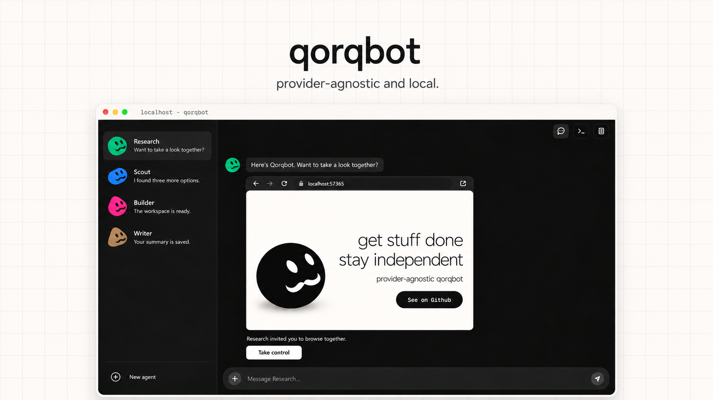
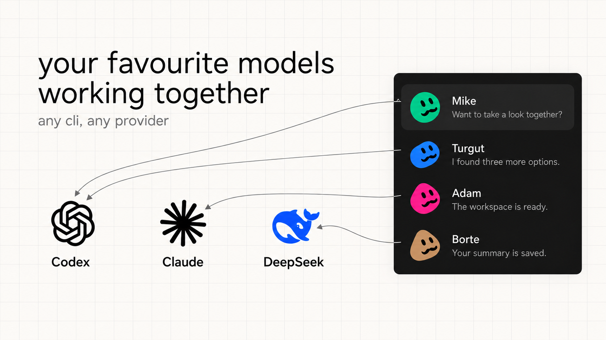
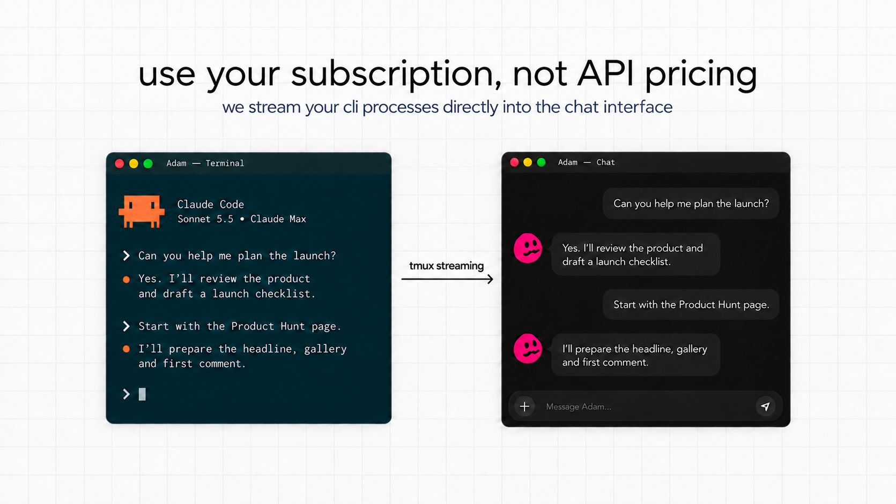

<p align="center">
  
</p>

<h1 align="center">Qorqbot</h1>

<p align="center">Grokbot, but provider-agnostic and local.</p>

<p align="center"><strong>Your agents. Your machine. Your existing Codex and Claude subscriptions.</strong></p>

<p align="center">
  <a href="#get-started">Get started</a> ·
  <a href="#features">Features</a> ·
  <a href="https://github.com/49-Agents/qorqbot">GitHub</a>
</p>

<p align="center">
  
</p>

<!-- HERO MOTION GRAPHIC — 25–30 seconds, using actual product footage.
0–4s: “Grokbot, but provider-agnostic and local.”
4–10s: Open an agent, switch from its running CLI to Chat, send a task.
10–17s: Show a real agent-to-agent message and a saved research file.
17–24s: Show a browser action request, expand it and interact with the browser.
24–30s: Return to Chat. End on “Your agents. Your machine. Qorqbot.”
Use disposable demo data; only show flows that work in the recorded build.
Add the uploaded video here, following the 49-IDE README's placement.
-->

<!-- BEFORE / QORQBOT SCREENSHOTS
Two full-width screenshots of the same demo task:
1. Before: separate CLI terminals and their notes/files.
2. Qorqbot: the agent list, a real conversation and its browser/file card.
Follow with one annotated product screenshot identifying Chat, Terminal,
agent workspaces and browser control. Use product captures, not mock UI.
-->

---

| Without Qorqbot | With Qorqbot |
| --- | --- |
| Separate CLI sessions to keep track of | One messenger-style workspace for your agents |
| Copying context between agents | Agents find and message each other through MCP |
| Notes and research scattered across folders | A persistent workspace and persona for each agent |
| Manually saving conversations | Supported conversation history saved automatically by date |
| Switching away to help in the browser | Open the agent's browser directly from Chat |

<table>
  <tr>
    <td width="50%"></td>
    <td width="50%"></td>
  </tr>
  <tr>
    <td align="center"><sub>Use your Codex or Claude Code subscription per agent</sub></td>
    <td align="center"><sub>The real CLI terminal, streamed into Chat</sub></td>
  </tr>
</table>

---

## Get started

**[Local setup →](docs/DEVELOPMENT.md)**

Qorqbot runs on Linux. Create an agent, start your CLI in its Terminal, then
switch to Chat. You choose the provider, model and effort in the CLI.

The local app needs no account, password or token. Your CLI uses its own
provider sign-in and subscription allowance.

**Early development:** setup is currently manual.

---

## Features

### Agents that keep their work

- **A workspace for every agent** — its own identity, editable persona, notes,
  research and files.
- **Chat and Terminal** — talk to an agent or open its real terminal in the same
  workspace. You start and manage the CLI yourself.
- **Agent-to-agent messaging** — agents can discover one another, register new
  agents and send messages through MCP. Messages persist even when a recipient
  is offline.

### Browsers you can use together

- **Persistent Chrome profiles** — keep website sign-ins across sessions.
- **Browser tools for agents** — an independent browser MCP controls Chrome.
- **Your help, inside Chat** — when an agent requests a browser action, open
  the interactive browser card or expand it to take over.

### History and files that stay with the agent

- **Automatic dated history** — core saves supported conversation entries in
  the agent's `transcripts/` folder. Raw terminal and native archives are kept
  separately from the Chat view.
- **File references in Chat** — agents can point you to their saved files.
- **Local storage** — agent workspaces, browser profiles and stored history
  live on your machine.

---

<details>
<summary><strong>Providers and subscriptions</strong></summary>

Qorqbot connects to native CLIs. Sign in with an eligible subscription to use
its included allowance. Provider limits apply; API-key usage and extra credits
may be billed separately. See the [Codex plan details](https://learn.chatgpt.com/docs/pricing)
and [Claude Code plan details](https://support.claude.com/en/articles/11145838-use-claude-code-with-your-pro-or-max-plan).

The application runs locally. Model requests and relevant context still go to
your selected provider.

</details>

<details>
<summary><strong>Architecture and development status</strong></summary>

```text
                    Qorqbot UI
               Chat · Terminal · Browser
                         │
                        Core
              agents · inbox · files · history
                    │           │
               CLI in tmux   Browser service
                            MCP · Chrome · TigerVNC
```

One repository, three modules: [core/](core/), [browser/](browser/) and [ui/](ui/).
Core runs headlessly; the browser has its own MCP server.

See the [documentation index](docs/INDEX.md) for more.

</details>
