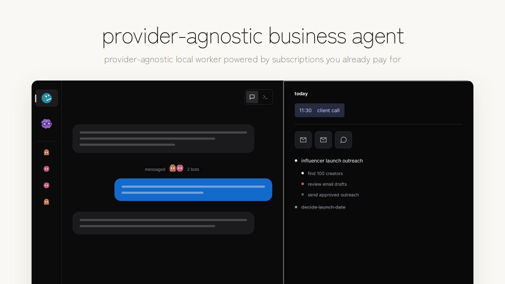

# qorqbot
**a proactive agent for complex work**

Qorqbot carries business workflows and long-running tasks forward in the background, bringing you the decisions that need your attention.

It runs on your machine, powered by the AI subscriptions you already pay for—Claude Code, Codex, and more.

- **Keeps work moving.** Coordinates tasks, client relationships, and workflows across agents.
- **Manages your attention.** Brings you decisions and blockers, with Signoffs for actions that need your approval.
- **Learns how you work.** Uses your conversations and feedback to improve preferences, skills, tools, and workflows.

Qorqbot works around your existing agent harness, adding shared context, operational tools, and an interface for working together. Extend it with your own skills, plugins, and integrations.

Early access. Built and used daily to run real operations.

[download](https://qorqbot.com/#downloads) · [website](https://qorqbot.com)

## Run it on a Mac

Needs an Apple silicon Mac (M1 or newer) on macOS 14 or newer.

1. Install the tools Qorqbot uses, with [Homebrew](https://brew.sh), in Terminal:
   `brew install python@3.12 git tmux`
2. Install at least one agent CLI and sign in to it once in Terminal:
   [Claude Code](https://docs.anthropic.com/en/docs/claude-code) (`claude`) or
   [Codex](https://github.com/openai/codex) (`codex`). You can use both.
3. Download `Qorqbot-VERSION-macos14-arm64.dmg` from the
   [Releases page](https://github.com/49-Agents/qorqbot/releases), open it and
   drag **Qorqbot** to **Applications**.
4. Open Qorqbot. The app is not notarized yet, so macOS blocks the first open:
   go to **System Settings > Privacy & Security** and click **Open Anyway**.
5. The first open installs into `~/Qorqbot/qorqbot` and opens the dashboard
   and a **Getting Started** page (also in the **Help** menu). To start an
   agent, open it in **Global > Agents**, click **>_** for its terminal, and run
   `claude` or `codex` there. Then switch back to Chat.

If a tool from step 1 is missing, the app says which one and shows the command to
copy. Details: [Mac guide](qorqut-code/docs/distribution/MACOS.md).
