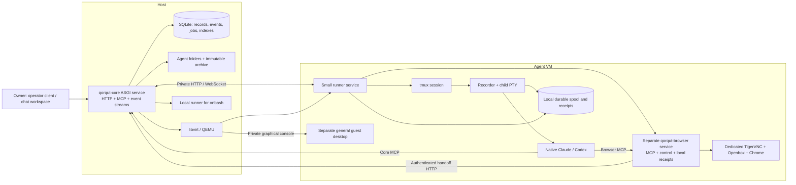

Current repository layout: [D61, one Qorqbot repository](../../docs/MONOREPO.md).
The module boundaries remain; older references to separate repositories describe
the pre-migration arrangement.

# Backend architecture

Current v1 scope: [D36, terminal-owned sessions](TERMINAL-OWNED-SESSIONS.md)
supersedes earlier automatic CLI start/restart/provider-switch and context-packet
requirements below. Creation establishes an agent and shell; the user starts the
CLI. One logical inbox owner connects Chat. See that plan for the exact current
creation contract and revised acceptance. VM setup remains open.

Status: planned. Shared IDs, states and operation names are defined in [CONTRACTS.md](CONTRACTS.md).

## 1. Process model



The host service and runner belong to `qorqut-core`. The host owns application decisions and configuration; the runner owns local process observations and execution/capture receipts. `qorqut-browser` runs as a separate service next to Chrome, owning its MCP endpoint, command/control receipts and browser effects. The recorder is a small process inside tmux, independent of the runner service's lifetime. It records native CLI output before forwarding it to the visible terminal and tails all sources registered for that run. `qorqbot-ui` is an independent client of the host API.

Host application restarts do not restart libvirt domains, runner services, tmux sessions, recorders or Chrome. Runner-service restarts do not terminate the recorder or native CLI. VM reboot is an actual process loss and must be recorded as such; persistent disks do not preserve a running tmux process across reboot.

Use a single ASGI worker process in v1. It runs a bounded set of supervised loops for durable jobs, reconciliation, host collection from runner spools, normalization and freshness transitions. Long I/O never holds a SQLite transaction. Blocking SQLite/libvirt work runs outside the request event loop. Background work has persisted cursors and retry state; a Python task object is not durable work.

Place each agent's managed tmux/recorder/CLI and desktop in independently supervised systemd runtime units/cgroups, outside the host and runner service cgroups, with no restart coupling to those services. Use an agent-owned tmux socket so unrelated sessions never share that runtime unit. Daemonizing tmux alone does not provide this isolation. Stop/pause operations address the owned runtime tree, including detached descendants. These are local process-supervision units, not extra application services or registries.

## 2. Repository and package boundaries

One repository, with three modules and separate package builds. Core has one host service and a runner; browser has its own per-browser MCP service; UI is a static client:

| Module / package | Owns | Depends on |
| --- | --- | --- |
| `core/` (`qorqut-core`) | Application configuration and coordination; agents/personas/files, VM/host runtime, tmux/CLI adapters, recording/history, messaging, continuity, durable requests, HTTP/MCP/operator APIs, installation and backup | The browser service from the same checkout, built separately, and its versioned control protocol |
| `browser/` (`qorqut-browser`) | Independent MCP server, Chrome/profile supervision, agent browser tools, takeover bridge, control receipts, TigerVNC/Openbox setup and remote-control transport | Explicit local configuration and application handoff API; no core/UI imports |
| `ui/` (`qorqbot-ui`) | Chat, navigation, inspector, browser/terminal viewer assets, interaction and client state | Core's versioned HTTP/events/WebSocket API |

Proposed source layout, created incrementally as modules are implemented:

```text
core/
  src/qorqut_core/
    app.py, config.py, contracts.py
    storage/             transactions, configuration, events, jobs, receipts
    agents/              registry, persona seeds, status, folder lifecycle
    environments/        libvirt driver, images and host target
    runner/              small control service, tmux and process receipts
    adapters/            Claude, Codex and terminal-only capability
    messaging/           threads, messages, attempts, handling receipts
    browser/             service client, durable requests and machine holds
    transcripts/         recorder, spool, archive, parsers and conversation
    continuity/          checkpoints, context packets and switching
    files/               workspace access and portable exports
    transport/           HTTP, MCP, events and authenticated stream proxies
    ops/                 init, migrations, backup, restore and diagnostics
  images/                guest image recipe, consuming browser setup assets
  tests/                 core behavior and integrated backend contracts

browser/
  src/qorqut_browser/
    contracts.py         MCP, control and handoff protocol values
    supervisor.py        Chrome, persistent profile, Xtigervnc and Openbox
    control.py           local command arbitration, epochs and receipts
    tools.py             browser actions and intent-only takeover bridge
    mcp.py               independent Streamable HTTP MCP server
    state.py             local command/control receipts and reconciliation
    remote.py            local VNC transport and input fencing
  setup/                 pinned prerequisites, units and setup instructions
  tests/                 browser behavior with a small handoff-API fixture

ui/
  src/                   API client, chat, agents, inspector and viewers
  assets/                pinned noVNC/terminal assets and icon artwork
  tests/                 focused interaction and API-integration checks
```

Agents, runtime and messaging are internal core modules, not separately published packages. The runner installs from core's wheel with a different entrypoint; it need not import host libvirt bindings. Browser installs as its own service with a tested release/protocol pin in core's installer and guest image. No Git submodules or fourth contracts repository are needed.

Browser exposes its tools through its own MCP endpoint. Each CLI connects to core MCP for coordination and browser MCP for browser work; core does not register duplicate browser tools. Browser forwards human-action requests to core's authenticated handoff operation, which atomically records request/event/job/conversation entry and owns Done/Cancel plus notification-message transactions. Local commands and VNC input fencing belong to browser. Machine-wide admission and coordination with terminal input remain core operations, reconciled through the runner's client of browser's private control API.

All direct MCP and runner-proxied browser actions share one service-owned lock, control epoch and durable command receipt path. Browser's small local SQLite store persists input ownership and uncertain outcomes independently of CLI/runner restarts. It is not a second host coordination database. Keep Chrome's runtime unit independent of the browser service as well, so service restarts preserve the profile/process and reconcile before accepting new input. Another application can configure the same server and its own handoff endpoint; absent that integration, automation remains available but takeover is not advertised.

Core owns its public API schemas and protocol version; browser owns its MCP/control wire contract. Core uses a small versioned client rather than importing tool implementations; schema artifacts can be generated from the owning models. UI consumes core schemas and supported versions, not Python internals. Build the UI independently; serve its static assets under the same origin through a proxy or optional core static-file mounting. Core's installation, MCP, jobs and operator client must work with no UI checkout or bundle.

### Configuration ownership

Core owns installation bootstrap settings, agent/runtime/browser settings, defaults and coordination state. Static paths/listen/network settings live in core's installation configuration; mutable defaults and agent revisions live in its SQLite records. Generated guest/browser settings and `agent.json` are projections. The browser package receives explicit validated configuration and never reads UI state or invents installation-wide defaults.

Core exposes non-secret effective configuration and revision-checked changes for supported defaults. UI forms submit those operations; validation, persistence and any lifecycle effects remain in core. Presentation-only state such as drafts, selection and collapsed panes may stay in the UI. Guest credentials and browser profiles are never application configuration downloaded to JavaScript.

Repository bootstrap moved backend contracts/module plans to core, the browser work package to browser, and retained the UI plan in UI. Link files replace moved normative copies. Repository separation does not require usage examples or example applications.

## 3. Data ownership and folder layout

The configured data root is independent of the source checkout and release directory:

```text
<data-root>/
  installation.json                    installation ID and static paths/config
  state.sqlite3                       host operational authority
  images/<image-digest>/base.qcow2     immutable shared dependency
  locks/                              host-local process locks
  agents/<agent-id>/
    agent.json                        recoverable identity/config projection
    workspace/                        virtiofs mount in VM; direct cwd for host
      AGENTS.md                       generated small entrypoint
      CLAUDE.md                       generated adapter entrypoint
      persona.md                      authored persona, role and instructions
      memory.md                       authored current handoff/checkpoint
      notes/
      research/
      data/
      files/
      downloads/
      scratch/
      .qorqut/generated/              prepared immutable/versioned inputs
    history/
      sources/                        reconstructable source manifests
      chunks/                         immutable raw transcript objects
      attachments/                    captured referenced assets
      context-packets/                exact restoration packets and provenance
    transcripts/
      YYYY-MM-DD.jsonl                core-published dated chat copies (UTC recording date)
    runtime/
      credentials/                    registration and runner identities
      vm/root-g<generation>.qcow2     boot overlay over pinned image
      vm/state.qcow2                  independent persistent ext4 state disk
      vm/domain.xml                   generated definition/provenance
      home/                          host-mode HOME only
      spool.sqlite3                  host-mode runner/recorder state only
      browser.sqlite3                host-mode browser command/control receipts
    exports/                          requested portable bundles/manifests
  backups/                            installation/archival backup manifests
```

Do not create a second canonical mutable configuration store in `agent.json`. SQLite is authoritative for display name/icon key, desired state, configuration revisions and coordination. The file is a versioned recovery/export projection containing agent ID, layout version, config revision and relevant pins. Reconciliation repairs stale projections from committed records. An imported folder needs an explicit import manifest; directory discovery never silently registers it as a new agent.

The agent folder is the unit of owned filesystem data. Full portability also requires the agent's slice of central records, included by export. Merely copying `agents/<id>` while the database is live is not a complete operational export.

Core automatically maintains `transcripts/` as described in D33 and M07. It is
a reserved backend output, separate from authored workspace and immutable raw
archive objects. Full exports include it. Existing agents acquire the directory
through the future transcript publisher's checked filesystem work; the accepted
initial registry implementation does not yet create or populate it.

### VM storage

Each VM has:

- A persistent writable root overlay over an immutable pinned base image.
- A separate ext4 state disk mounted by filesystem UUID at `/var/lib/qorqut-agent-data`.
- Persistent `home/` from that disk bound to `/home/agent`.
- Runner receipts and recorder spool on that state disk.
- Browser service control/command receipts in `browser.sqlite3` on that disk.
- Only its authored host workspace shared through virtiofs at `/workspace`.

Native CLI authentication/state and Chrome profile SQLite files stay on guest-local ext4. Chrome's profile is `/home/agent/.local/share/qorqut/chrome`; downloads go to `/workspace/downloads`. Do not place a running profile or native CLI store on virtiofs, NFS or a copied host personal directory.

Readiness fails if the intended state disk or workspace mount is absent. Never silently create an empty temporary HOME or workspace and start a new browser against it. Ordinary reboot preserves both root overlay and state disk. Explicit image replacement creates a fresh root overlay and retains the state disk through a tested upgrade path; it does not silently preserve arbitrary system packages installed into the old overlay.

### Host-global onbash

Onbash uses the same agent folder, recorder, CLI adapters, message contracts and history, with `environment.kind=host`. It has its own HOME, tmux session and Chrome profile. Its dedicated Chrome display and separate general desktop use distinct host display/VNC bindings allocated once and persisted, since the host has no VM port namespace. It does not reuse the existing Qorqut or owner desktop.

The host executor selects local operations; an unreachable VM is never converted to a host executor. Onbash has host access as requested. Per-agent VM separation and an unrestricted control API are not an adversarial multi-tenant security boundary.

## 4. Network and transport

Use one installation-owned libvirt NAT network in v1. Persist its non-conflicting subnet, bridge address and DNS configuration. Give each domain a stable UUID, MAC and DHCP reservation; every guest can use the same internal service ports:

| Endpoint | Location | Purpose |
| --- | --- | --- |
| Runner HTTP/WS `8091` | Guest private interface | Host control, receipts, transcript transfer and proxies |
| Browser MCP/control HTTP/WS `8092` | Guest loopback only | Separate `/mcp` server for local CLIs; private control/command/relay API for the runner |
| VNC `5901` | Guest loopback only | Dedicated Chrome application desktop |
| Libvirt graphical VNC | Private host Unix socket per VM | Separate general machine desktop; no public console port |
| Chrome CDP `9222` | Guest loopback only | Browser automation |
| Host HTTP/MCP | Configured host/bridge addresses | Owner console/API and agent MCP |

The host finds a guest through its recorded domain/network reservation, then verifies the runner's agent ID, environment generation, boot ID and protocol. An IP address is a route, not identity.

The runner verifies browser-service identity/protocol before forwarding control, commands or VNC. Onbash persists its own unused browser-service port with the other local bindings. Native clients register distinct `qorqut-core` and `qorqut-browser` MCP entries. Each browser service executes only its bound local browser; explicit cross-agent requests use core's target routing to the destination service without changing actor attribution or executing twice.

Bind private host/guest requests using per-agent transport credentials. Bind CLI MCP requests to their registered actor identity. Identity checks supply attribution and prevent misrouting; they do not authorize different operation sets. Every registered actor receives the same v1 domain operations. Keep guest transport credentials out of browser JavaScript and command-line logs.

Use ordinary HTTP request/response and WebSockets with versioned envelopes, bounded bodies and cursors. No custom multiplexing protocol, service mesh or per-agent public host-port range is required. External access, if configured, terminates TLS at the host service or a conventional reverse proxy; never publish guest CDP or VNC directly. The private single-host trust assumptions and exact listen addresses must be explicit in installation config.

### Desktop and terminal viewers

The UI supplies pinned noVNC and terminal-emulator assets. Browser viewing goes through core's authenticated proxy/runner to that agent's dedicated TigerVNC Chrome display. Machine viewing targets its separate guest graphical console (private libvirt VNC with a usable general desktop), or onbash's separate local desktop. `surfaces_list` and surface IDs keep these bindings explicit. A terminal connection attaches to existing registered tmux through the runner. Opening, closing or reconnecting viewers does not start/kill agents. Other clients can use the same core stream contracts without this UI.

The single-page UI has agent navigation, central chat and a collapsible inspector. A browser-request card is full-width and directly interactive once human control is ready; expansion uses the same viewer/surface. Reuse one UI viewer instance across inline/modal/inspector to avoid duplicate input owners or competing display resizes. Machine takeover coordinates the existing terminal/browser gates. See [UI-PLAN.md](UI-PLAN.md) for layout, twenty icons, inline rename, file cards and monochrome styling.

Manual terminal input and automated paste share a per-run input lock. `terminal_control` takes or releases control with an exact run binding and a monotonically increasing control epoch. A disconnected input viewer leaves human mode in place until explicit release or takeover; there is no automatic expiry in v1. Stale same-run viewer epochs cannot type. The composer is rechecked before automation resumes without clearing human text. A viewer that only observes does not take control.

## 5. Authority and durable effects

| Concern | Authority | Recoverable derivative |
| --- | --- | --- |
| Agent identity/config/current state | Host SQLite | `agent.json`, directory/API responses |
| Status/state/creation/message history | Host SQLite append-only events and message records | UI lists, exports |
| Authored persona/notes/research/data/files/memory | Agent workspace files | Generated CLI entrypoints, file listings, hashes, exports |
| CLI/VM/browser processes | Actual inspected process/domain plus generation-bound observations | Current rows and UI state |
| Locally captured, not yet archived bytes | Runner/recorder spool | Host-pulled transfer batches |
| Local browser command outcomes/input ownership | Browser service receipt store | Core observations and reconciliation receipts |
| Host-acknowledged transcript bytes | Immutable host chunk files + committed inventory | Parser records, conversation, FTS |
| Context sent to a replacement CLI | Saved context packet + delivery receipt | Startup summary |
| Browser/file cards | Core M06 request or M09 file-reference record plus conversation entry ledger | UI cards, attention indicators, optional transient toast |

Use current tables plus an append-only event journal, not a general event-sourcing framework. Record a mutation, its event, operation receipt and required durable job in one transaction. Events preserve old/new status text and relevant state, actor, target IDs and timestamps. Unchanged heartbeats do not append status-change events.

Filesystem and process effects occur outside the SQL transaction using explicit receipts. Their workers reconcile the exact saved target/generation after a crash. A database lease only fences database ownership; a host-local lock held throughout a libvirt effect prevents an expired worker from continuing to mutate a VM while another begins.

Lifecycle intent has its own revision. Archive closes launch admission and invalidates queued start/restart/switch intent under the same per-agent lifecycle lock; effects already in progress are settled and then stopped. Jobs check current intent before acting. `runtime_stop` stops only the managed CLI, preserving the environment/browser; archive stops the agent's whole managed execution environment. Only explicit restore reopens an archived identity, with no automatic model start by default.

Input delivery is a special external effect. Record intent before paste. An attempt that might have pasted or pressed Enter becomes uncertain until evidence resolves it; there is no automatic second paste. Submitted input and semantically handled work have different receipts.

## 6. End-to-end flows

### Create, open Terminal, connect Chat

1. Creation commits identity/status/history and provisions the owned workspace.
2. Environment readiness permits a persistent tmux shell at that workspace;
   creating/opening the shell does not start a CLI.
3. The user starts or resumes a CLI and chooses its configuration in Terminal.
4. Startup integration requests inbox ownership. Existing active owner wins;
   reconnect of that exact running session succeeds, a competing session waits.
5. Core binds inbox/Chat and capture to the observed native session. View changes
   do not affect its lifetime; exit disconnects delivery while retaining history.

### Message another agent

1. Sending commits the complete attributed message, thread link and pending delivery.
2. Delivery waits for a capture-ready, correctly bound runtime and an available input composer.
3. The runner serializes a bracketed paste/Enter and returns a durable outcome. The host saves the outcome.
4. The recipient reads/acknowledges exact message IDs. Reads and replies do not acknowledge the parent automatically.
5. If the recipient is offline, the message remains queued. Starting it is a separate recorded action, not an implicit side effect of reading messages.

### Human browser input

1. Browser's intent-only MCP tool forwards an attributed, idempotent request to core; core atomically records request, conversation entry/event and the control-transition job. A lost response is reconciled by that same key.
2. Core sends the desired epoch through the runner to browser's control API. Browser closes automated admission and waits for in-flight commands to settle; only its acknowledgment makes human control ready.
3. The chat renders an inline interactive viewer of that same dedicated Chrome/profile, with a top-right modal expansion. Input is enabled after control is ready.
4. Done completes the exact request, advances control epoch, records the answer and queues one attributed completion message in the same host transaction.
5. Reconcile the new control epoch through the runner with browser before admitting automation, including direct browser MCP calls. The agent observes the page again; Done is not proof of successful login.

### Reference a file

Resolve the supplied path inside the selected agent workspace/environment, inspect its metadata, and atomically save the reference and conversation entry. The chat shows one persistent file chip with copy-path access; direct opening/preview is deferred. Event replay/native transcript parsing updates the same card rather than calling the tool again. Referencing does not create an implicit content snapshot or claim the user viewed it.

### Provider switch

Freeze new automated delivery, reach/choose a stop boundary, drain known sources, stop the old run and verify exit, and finalize capture evidence. For a context packet, wait for parsing through the selected raw checkpoint and snapshot exact memory/artifact bytes; otherwise choose verified native resume. Prepare and launch the replacement, verify capture/native readiness and the selected restoration outcome, then release queued messages. Native resume does not add another automatic startup prompt. Reuse the VM, browser profile and agent ID. Failure leaves a persisted recoverable operation, not a hidden rollback to a different model.

## 7. Backup and failure boundaries

An online **archive backup** can snapshot host SQLite and copy the immutable chunks referenced by that snapshot while new capture continues. There is no automatic archive deletion, so this inventory remains valid.

A **full agent or installation backup** includes live files, native stores and VM disks. V1 uses stopped backups: drain, quiesce all included writers, shut down included guests, verify stopped state, then copy disks/workspaces and a matching DB export. Do not copy live qcow2 images and claim application consistency. The backup records its actual recovery point and exact image dependencies.

Restore verifies hashes and identity before activation. A full-installation restore needs an inactive destination; a single-agent import needs an unoccupied agent identity and a consistent central-record merge. A new recovery epoch and reissued credentials fence old control. Restored unfinished external-effect jobs/deliveries remain held for reconciliation because the original installation may have performed them after the backup. Missing receipts are not proof of no effect. Intentional clone creates a new current identity/provenance; v1 rejects cloning onbash into another host agent.

Disk pressure is a first-class health condition. Stop admitting new work before spool/archive exhaustion, and pause affected producer subtrees when needed while recorder/runner remain runnable. Keep already captured bytes; never rotate away the oldest transcript to make progress. See M07/M11 for thresholds and fault tests.
