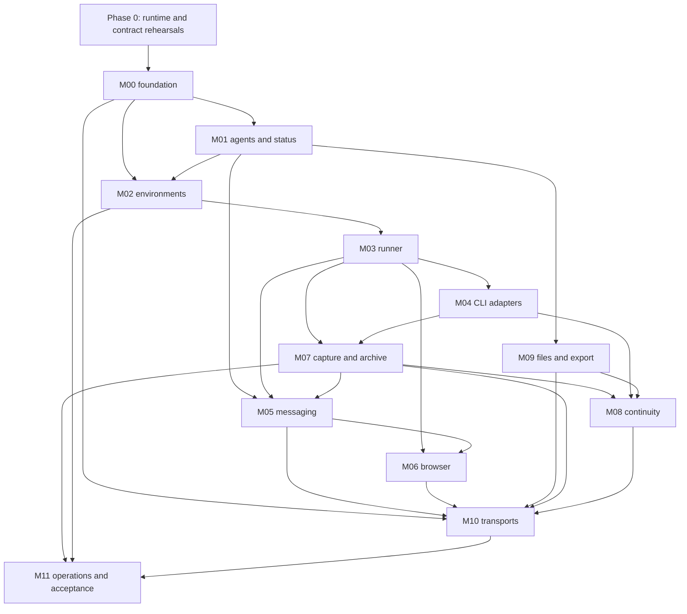

D60: [Terminal capture storage and recovery](TERMINAL-STORAGE-RECOVERY.md)
addresses large-ledger scans and the failed onbash terminal, preserving capture
and public contracts.

D59: [Native attention in Chat](NATIVE-ATTENTION.md) adds visible approval and
question notices backed by fresh observations of the current native terminal.
Implementation and deployment are pending.

D58: [Codex composer compatibility](CHAT-COMPOSER-COMPATIBILITY.md) corrects
the normal narrow-terminal and warning-footer layouts that are currently
preventing the owner's stored Chat messages from being dispatched.

D57: [Connected browser integration](BROWSER-APP-INTEGRATION.md) is the current
implementation contract for attached browsers, durable handoff and the UI stream.
The [combined browser evidence](evidence/browser-connected-manager-acceptance.md)
records actual Chrome/TigerVNC/noVNC interaction, restart, durable notifications,
dated publication and deployment. VM/machine and full-system gates remain open.

D56: [Terminal control follows the open view](TERMINAL-AUTO-CONTROL.md)
supersedes Terminal-viewer hold retention on close/disconnect.

# Qorqutbot backend implementation plan

2026-10-09 browser update: standalone host Chrome/TigerVNC/MCP implementation
`19c4577` is merged and deployed beside onbash, with a separate persistent
profile and no application authentication. The worker's installed-wheel real
browser flow passed; the owner waived further review. See
[deployment scope](evidence/browser-host-deployment.md). Core-managed browser
configuration, native-CLI MCP registration, the handoff endpoint and UI/noVNC
viewer remain integration work; this does not pass G4/G6 or VM acceptance.

[D55 local access](LOCAL-ACCESS.md) supersedes earlier application authentication:
the owner requested no login, tokens or passwords. Core and UI passed
[paired acceptance](evidence/local-access-manager-acceptance.md) and the owner test
instance now opens directly, retaining actor attribution and durable history.

Accepted and integrated: D46 [host dispatch](evidence/host-message-dispatch-manager-acceptance.md)
and D48 [continued native collection](evidence/native-collection-continuity-manager-acceptance.md).
The [actual core/MCP/file-card flow](https://github.com/qorqutbot/qorqutbot-ui/blob/main/docs/evidence/file-reference-integration-manager-acceptance.md)
also passed bounded acceptance. The [connected Chat reports](evidence/connected-chat-manager-acceptance.md)
now have bounded Manager acceptance: Codex completed actual native MCP reads,
acknowledgments, replies and a fresh message after core restart; Claude's native
MCP calls were blocked, while notification/restart evidence passed. The [combined responsiveness recheck](evidence/startup-and-responsiveness-manager-acceptance.md)
passed after D50's contiguous transfer ranges: 24 successful burst reads,
2.895-second archive catch-up and recording through core restart. The original
r1 failure and two unexplained r2 log diagnostics remain documented.
[D51 startup connection](NATIVE-STARTUP-CONNECTION.md) and
[D52 first Chat](evidence/first-chat-manager-acceptance.md) are accepted for
pinned Codex: manual launch, first Chat without a seed, actual native tool calls
and automatic transcript publication. [D53 inbox references](INBOX-REFERENCE-VIEW.md)
passed [paired core/UI acceptance](evidence/inbox-reference-manager-acceptance.md),
separating compact Chat presentation from the preserved native pointer.
[D54 exit checkpoints](NATIVE-EXIT-CHECKPOINTS.md) passed
[focused Manager acceptance](evidence/native-exit-checkpoints-manager-acceptance.md)
for the final bounded collection pass and finite byte evidence after observed exit.
It does not claim all-source completeness or stop the user's CLI.
Manager reviews/tests directly;
workers use Astra MAX with self-review off. The D57 core candidate has schema 10, 24 public
operations and six handlers; combined browser/UI acceptance and deployment are
Manager-owned and pending. These qualified runs do not establish
complete transcript coverage. Shutdown drain,
child/attachment support, browser/VM integration and full system gates remain open. D52 resolves the initial seed dependency for the tested Codex flow; Claude
has unit coverage for the same collector waiting path but no renewed MCP acceptance.

Current v1 scope: [D36, terminal-owned sessions](TERMINAL-OWNED-SESSIONS.md)
supersedes earlier automatic CLI start/restart/provider-switch and context-packet
requirements below. Creation establishes an agent and shell; the user starts the
CLI. One logical inbox owner connects Chat. See that plan for the exact current
creation contract and revised acceptance. VM setup remains open.

Status: global plan, updated 2026-10-08. The reviewed core primitive package is
merged in PR #1; [BUILD-EXECUTION.md](BUILD-EXECUTION.md) records exact bounded
acceptance. No deployment or complete system gate has been accepted.

D37's [inbox ownership](INBOX-OWNERSHIP.md),
[persistent recorded shell](RECORDED-SHELL.md) and
[adapter corrections](ADAPTER-REHEARSAL-FIXES.md) increments have passed bounded
acceptance. The [paired creation integration](MANUAL-CREATION-INTEGRATION.md)
has also passed [independent review and Manager acceptance](evidence/manual-creation-integration-manager-acceptance.md)
against the actual compiled UI and installed console server. Within D37, only
ownership changes host schema/application assembly. Connecting
startup hooks, recorded shells, Terminal UI, delivery and native capture remains
the following runtime integration; accepted components alone do not prove it.

D38's [host Terminal server](TERMINAL-SERVER.md) has passed fresh independent
review and [Manager source acceptance](evidence/terminal-server-manager-acceptance.md).
The parallel UI Chat/Terminal switch is also reviewed and merged. Their real
compiled-UI/installed-core check of the recorded onbash shell has passed.
Native inbox/Chat/history connection remains a distinct following step, with
accepted factual inputs.

The combined D38 check exposed read-only terminal clipping. The required
[geometry correction](TERMINAL-GEOMETRY.md) carries native pane dimensions into
each mirror and the scrollable UI, using protocol 2 for the corrected pair.
The corrected pair passed the [real Terminal integration](evidence/terminal-integration-r1.md),
including restart/outage recording and read-only mobile scrolling. This is
recorded Bash acceptance, not native CLI or complete G2/G3 acceptance.

D39's [native connection work](NATIVE-CONNECTION.md) now proceeds in three
parallel implementation lanes alongside the Terminal correction. The owner has
requested direct Manager review/testing in place of mandatory separate reviewer
actors. The connected runtime gate still requires an actual combined flow.

D40's [normal native composition](NATIVE-COMPOSITION.md) now joins accepted
hook/capture/projection seams: owned hook/MCP setup and continuous native history
collection are accepted and composed. Focused composition checks pass; qualified
actual-CLI config-loading facts are recorded. Parallel [Claude/Codex workflow
acceptance](NATIVE-WORKFLOW-ACCEPTANCE.md) now checks the complete connection.
No automatic CLI launch is added.

D41's [automatic Terminal host archival](evidence/terminal-archive-manager-acceptance.md)
and UI queued-input batching have passed bounded Manager acceptance and are merged.
Qualified Claude/Codex manual-session history checks are also accepted. Chat
submission remains unfinished and current native-input observations are factual
inputs to its design. D42 adds [session/native-history inspector presentation](https://github.com/qorqutbot/qorqutbot-ui/blob/main/docs/RUNTIME-INSPECTOR.md)
using existing runtime_get; it adds no input readiness or lifecycle authority.
A separate factual file-reference survey can proceed without those dependencies.

## 1. Product contract

Qorqutbot hosts persistent agents. A logical agent owns its identity, files, notes, research, browser profile and accumulated history independently of the currently selected CLI, model, native conversation or VM process. Agents work in interactive tmux-backed terminals and coordinate through Qorqut MCP. The owner can create agents, inspect them and intervene in their browsers. Agents can create and contact other agents themselves.

The owner values lean code and high quality, with no deadline-driven reason to weaken correctness. Minimize deployed components and duplicated concepts. Use selective extraction, focused failure tests and recovery rehearsal; no usage examples, example applications or redundant test suites are required.

### Required v1 behavior

| Requirement | Concrete meaning | Primary modules |
| --- | --- | --- |
| R01 Stable agents | Immutable UUID, dedicated `agents/<UUID>` folder with editable `persona.md`, notes/research/data; display names/icons are independent; IDs survive ordinary changes | M01, M09 |
| R02 Create from either actor | Owner and agents call the same create operation; creation/workspace/shell provisioning have inspectable progress; CLI startup is manual and permanent creation history | M00–M04, M10 |
| R03 Per-agent environment | Each ordinary agent has its own persistent Linux VM, workspace, native CLI stores and desktop | M02, M03 |
| R04 Host-global onbash | Exactly one reserved global host agent; same contracts and files, no VM | M01–M04 |
| R05 CLI/model independence | Claude and Codex initially; model choice belongs to configured CLI adapters rather than platform identity | M03, M04, M08 |
| R06 Persistent browsers | Dedicated Chrome profile and TigerVNC browser display per agent, separate from machine console; control/human intervention and retained login state | M02, M06 |
| R07 Durable coordination | Complete direct messages, threads, timestamps, sender/recipient identity, offline delivery and explicit handling receipts | M05 |
| R08 Advertised state | Every agent is discoverable with ID/name, current status, activity and freshness; status is at most 100 words | M01, M10 |
| R09 Permanent changes | Every changed status/state and every creation is recorded; message history does not expire | M00, M01, M05 |
| R10 Complete captured history | All supported native streams and terminal output are collected with visible health, durable retry and no whole-file ceiling; core automatically maintains dated chat copies in each agent's `transcripts/` folder | M03, M04, M07 |
| R11 Provider changes preserve work | Same agent and logical history; files/browser persist; the user starts the new CLI in Terminal; shared memory/history remains available | M08, M09 |
| R12 Unrestricted v1 | No role grants, capability policies or signoff engine; caller identity and target validation remain | M00, M10 |
| R13 Single-page chat UI | Left agent list, central conversation, collapsible right inspector; inline live browser requests with modal expansion; separate browser/machine control | M02, M06, M07, M10 |
| R14 Recoverable operation | Restart, backup, restore, disk pressure and software upgrades have tested outcomes | M02, M07, M11 |
| R15 Intent-based user presentation | Browser-action and file-reference tools describe user intent; durable cards survive replay/provider switches; file opening/preview deferred | M04, M06, M07, M09, M10 |
| R16 Agent appearance | Independent display name/icon, twenty fixed monochrome icon choices, creation picker and double-click inline rename; stable IDs for routing | M01, M10 |

“Always collect” has a precise storage contract in [M07](modules/07-transcripts.md). Captured bytes must not silently disappear. Provider-internal data never emitted, a killed CLI's unflushed buffer, and physically lost storage without backup are outside an achievable collection guarantee. These limits are exposed as health/evidence, never concealed by claiming complete Chat.

Under D33, every owner/agent chat also produces automatic dated transcript files
in `agents/<id>/transcripts/`, including both sides of the conversation. Core
owns saving and restart recovery independently of the UI, selected CLI/model
and any optional export action. M07 owns publication; M09 preserves the files
in full export/restore. This is a required part of the completed chat workflow.

## 2. Chosen shape

Use exactly three source repositories:

| Repository | Responsibility |
| --- | --- |
| `qorqut-core` | One backend: agents/personas/workspaces, runtime/tmux/CLI, recording/history, messaging, all coordination and application configuration, HTTP/MCP/operator APIs, installation/backup |
| `qorqut-browser` | Independent browser MCP server, Chrome/profile lifecycle, agent controls, takeover bridge, TigerVNC setup and remote-control transport |
| `qorqutbot-ui` | Independent frontend consuming core's API/events/streams; chat, viewers, inspector and appearance |

Agent management, runtime and communications remain modules inside core. Browser runs its own MCP service and imports neither core nor UI. Each native CLI connects to core MCP and its agent's browser MCP separately; browser tools are not re-exported by core MCP. Core supplies configuration and a local handoff API that commits requests and notifications through shared operations. UI owns presentation and may edit configuration through core; it owns no backend orchestration or authoritative configuration store.

The deployment stays lean:

1. One core ASGI application serves HTTP, Qorqut MCP, event streams and authenticated viewer proxies. It operates without the UI. A UI build may be served as optional static assets or through a same-origin proxy.
2. One host SQLite database owns registration, coordination, state transitions, operation/job receipts and history indexes.
3. Each agent's host folder owns its authored workspace, immutable transcript archive and execution files/disks.
4. Each VM runs a small runner and an independent browser MCP service. The host-global agent uses separately bound instances locally. Browser runs next to Chrome, with a private MCP endpoint and local command/control receipts; core remains the application coordination authority.
5. A recorder inside each managed tmux session wraps the native CLI. Independent systemd runtime units preserve it across runner-service restarts. It durably spools terminal/native bytes for the host collector to pull and acknowledge.
6. Each agent retains a dedicated TigerVNC Chrome display/profile, distinct from the general machine desktop/VM console. Browser MCP calls and runner-proxied commands/control enter the same browser service and command gate. The host proxies both surface types through the same viewer components; no separate Guacamole deployment.

Use Python 3.12, stdlib SQLite, one validation model family, the official MCP SDK, Starlette/Uvicorn, tmux, QEMU/KVM/libvirt, virtiofs, Chrome, TigerVNC/Openbox, and a pinned `agent-browser` adapter. Exact package and image versions are pinned after compatibility rehearsals. No Redis, Kafka, external search engine, model SDK runner, multi-node scheduler, role catalog, general workflow engine or business schema is needed for v1.

The concrete architecture is in [ARCHITECTURE.md](ARCHITECTURE.md). Public names, states and ownership are in [CONTRACTS.md](CONTRACTS.md). The owner's chat layout, intent tools, icons, rename and visual direction are specified in [UI-PLAN.md](UI-PLAN.md); reference images will refine its styling.

M00–M05, M07–M09 and M11 belong to core. M06 specifies the independent browser MCP service plus its core integration; M10 specifies core's transports/operator client and the separate UI implementation. These module plans describe work packages, not additional repositories. D20/D21 record the agreed split.

The initial planning repository is now the UI destination. Core and browser have their own repositories; authoritative plans follow those owners and old locations contain links. Pin package/API compatibility directly; do not add Git submodules, a shared-contracts repository or another coordination service.

## 3. Planning defaults and decisions

The owner has been asked two preferences. This baseline proceeds with explicit defaults:

- **D02:** “Own VM” means a real QEMU/KVM Linux VM, not merely a container or separate VNC display.
- **D36 supersedes D08:** provider/client changes are manual in Terminal. Identity/files/history persist; automatic context packets are deferred outside v1.

If the owner changes either preference, update the decision and affected module plans before implementing that dependency. Identity, message storage, raw archival and operation contracts are useful under either choice. No reply is treated as confirmation.

Other decisions are recorded in [DECISIONS.md](DECISIONS.md), including one active managed CLI per agent, independent raw history, host-pulled capture, explicit control epochs and lifecycle precedence. Full restore uses a new recovery epoch and holds unfinished external effects for reconciliation; uncertainty is never resolved by automatic replay.

The bounded [live recorder observation](RECORDER-PROBE.md) increment closes the
process-local observation gap found in reviewed runtime exploration. It remains
separate from complete native capture, provider readiness and managed launch.

The bounded host storage boundary is [HOST-ARCHIVE.md](HOST-ARCHIVE.md), specified
by D31. It consumes exact declared source coordinates and produces a receipt
only after immutable bytes and inventory are durable. The authenticated pull
collector, native ingestion, restore audit and G3 acceptance remain separate.

The accepted native exploration exposes a missing full-prefix verification
path after spool reclamation. [NATIVE-PREFIX.md](NATIVE-PREFIX.md), D32, supplies
that read-only prerequisite using existing receipt hashes. It adds no storage
or service and does not itself provide a native reader or durable checkpoint.

## 4. Porting strategy

Qorqut is a source of working mechanisms and hard-earned failure behavior. Each extraction must have a named contract and a meaningful test before integration.

- **Extract narrowly:** tmux buffer paste/Enter, PTY mirroring, native process fingerprints, composer fixtures, browser adapter command translation, desktop shutdown/profile flushing, useful native record parsers.
- **Adapt deliberately:** per-client preparation and hooks, generation-bound sessions, message/outbox receipts, all-agent Chat projections, owner-Done/message atomicity.
- **Implement new:** agent-ID folder registry, durable status history, libvirt driver, guest protocol, recorder/spool/archive, all-source transcript registry, cross-client restoration.
- **Leave behind:** business IDs/namespaces, fixed business-agent/Dev roster, role/plugin policy, signoffs, marketing/task/Fleet workflows, business proxies, huge domain bootstrap, legacy snapshot ceilings and current-marker-only collection.

The [porting matrix](PORTING.md) names exact source commits, files, tests and destination ownership. It does not authorize copying operational data or modifying Qorqut. The new packages must run without a sibling Qorqut checkout.

Do not begin by copying large modules and deleting code until tests pass. First identify the retained behavior, build its small destination API and fixtures, then extract or rewrite the minimum implementation. Preserve applicable source notices and record the origin of substantial adaptations.

## 5. Dependency and delivery order

The order is gate-based, not date-based. Unlimited development resources permit more independent review and better tests; they do not remove dependencies between durable contracts.

M10 starts early with a thin transport skeleton; its full acceptance waits for the domain modules. M11 contributes installation, fault-injection and supervision scaffolding from Phase 0; backup/release completion waits for the integrated system. Neither is postponed until the last week of development.

### Phase 0 — Prove the expensive assumptions

Begin implementation by bootstrapping private `qorqut-core` and `qorqut-browser` repositories in the `qorqutbot` organization, moving the owning plans, and establishing the minimal package/API boundaries above. `qorqutbot-ui` remains the UI repository. Then deliver disposable technical rehearsals and decision records; these are not product acceptance.

1. Verify host prerequisites: hardware virtualization, libvirt access, QEMU, virtiofs, image tools, disk space and network overlap. The inspected machine has `/dev/kvm`, but this account lacked direct read/write access and QEMU/libvirt commands were not on PATH. No readiness claim follows from the device existing.
2. Boot two disposable guests with a shared immutable base, independent root overlays/state disks, separate virtiofs workspaces and one private NAT network.
3. Prove fixed-port runner HTTP/WS, bound identity, native CLI discovery of separate core/browser MCP endpoints, tmux reconnect/input and noVNC for dedicated Chrome and distinct usable machine desktop. Prove private libvirt graphics routing for VMs and independent local desktop allocation for onbash.
4. Prove Chrome cookie persistence and distinct profiles across browser restart and VM reboot with synthetic local sites.
5. Prove a nested-PTY recorder preserves CLI interaction, resize, Unicode, bracketed paste, signals and durable output ordering, including startup signal delivery and bounded cleanup of the direct child and its verified PTY session (D27). Prove owned runtime cgroups survive actual runner-service restart and allow pausing producers while capture remains runnable. This is a go/no-go technical gate for the strong terminal recording contract.
6. Pin and rehearse Claude/Codex native source/hook/resume contracts using isolated fake provider endpoints where possible. Identify parent/child transcript stores and attachments.
7. Rehearse a stopped agent backup/restore and runner reconnect without an extra model turn.
8. Select dependency versions and record executable image/package hashes. Resolve D02/D08 changes if the owner supplied them.

**Gate G0:** both guest isolation and the recorder work under disposable tests; adapter evidence names exact versions; assumptions and unresolved limits are written down. No production agents or accounts are used.

### Phase 1 — Durable core and agent identity

Implement M00 and M01 and the thin M10 transport. Add the workspace layout from
M09. The first concrete [agent increment](AGENT-REGISTRY.md) uses real durable
registration and workspace jobs with an explicit runtime-dependency hold;
synthetic test fixtures never become production fake-ready executors.

The first concrete transport increment follows [CORE-API.md](CORE-API.md) on the
reviewed M00 foundation. It exposes only the four implemented configuration,
operation and event handlers; M01 and later domain handlers join after review.

Deliver core-owned configuration, atomic operation receipts, event history, typed durable jobs, a stable agent registry with display names/icon keys, create/rename/archive, the reserved host onbash identity, status validation/history, explicit observed activity/freshness, and shared HTTP/MCP operation behavior. Seed editable `persona.md`, memory and workspace directories once; descriptive roles live in the persona and v1 remains `allow_all`. Freeze the twenty-icon key catalog in core without adding custom image uploads; UI owns the artwork.

**Gate G1:** concurrent/retried creation yields one ID and one creation event; changed statuses survive restart; 101-word text is rejected identically by every transport; no business or role-policy dependencies exist.

### Phase 2 — Persistent execution environments and terminals

Implement M02/M03 and core M04 preparation. Bring the proven recorder skeleton into managed launches immediately, even before rich history rendering.

Deliver one real VM per ordinary agent, the host executor, immutable image pins, persistent disks/home/workspace, authenticated runner identity, one active run per agent, tmux terminal streaming and serialized input receipts. Add explicit terminal take/release epochs and lifecycle intent fencing so stale viewers and queued starts cannot override control or archival. Surface “not ready” when mounts, credentials or native CLI setup are missing.

Automated text delivery also enforces D23's control-character rule before any
input, preserving stored messages while rejecting payloads that could escape
bracketed paste and bypass the separate guarded Enter.
Apply D24's explicit transport framing and refresh exact-paste/safe-Enter
evidence after the durable Enter intent, before input. Local framed-byte tests
do not substitute for supported native-composer acceptance.

**Gate G2:** two agents and onbash run independent terminals; host service restart preserves live VM/tmux/browser processes; VM reboot is recorded as a different execution situation; stale commands cannot reach a replacement run; uncertain input never repeats automatically.

### Phase 3 — Continuous archive before autonomous operation

Complete M07 with both native adapters from M04. Add the required storage-pressure behavior from M11.

Deliver durable all-source registration, local transactional spooling, immutable host chunks with fsync-before-ACK, resumable transfer, explicit gaps, native children/attachments, rebuildable parsing and FTS search. Remove every dependency on a “current session file” being the only history source.

**Gate G3:** interruption at every chunk/cursor/file/DB/ACK boundary loses no acknowledged byte; transcripts larger than 8 MiB and giant records survive; host/runner outage and source changes preserve provenance; disk pressure never silently drops output. Until G3 passes, agents are test sessions, not an operational autonomous fleet.

### Phase 4 — Coordination and browser intervention

Browser's standalone MCP/HTTP transport increment follows its owned
[protocol v1](https://github.com/qorqutbot/qorqut-browser/blob/19c4577795f20ffd4261ca41464afb63767cb046/docs/PROTOCOL.md).
Its reviewed local gate remains the sole effect/control path. Implement core's
durable handoff endpoint against that contract; transport fixture success does
not replace real VNC/input enforcement or core transaction acceptance.

Complete M05/M06 and the operational portions of M10. Browser supervision/tools develop in `qorqut-browser`, durable coordination and integration in core, and presentation in `qorqutbot-ui`. Browser work can proceed in parallel with Phase 3, but unattended work waits for capture readiness.

Deliver direct messages/offline queues, guarded terminal delivery, semantic handling receipts, dedicated browser/machine surfaces and input request/Done/Cancel transitions. Add M09 file references, M07 conversation projection and the M10 single-page shell: agent list/icons/rename, central chat/composer, inline browser cards with expansion, compact file cards and collapsible inspector. File opening is deferred. Manual browser takeover reuses the request state machine. Tools describe intent without layout mechanics. All agents can discover/contact/create peers through shared operations.

Core automatically publishes dated per-agent chat transcripts as those durable
conversation entries arrive, including after reconnection or provider switching.
File publication and restart/replay acceptance do not depend on the UI being open.

**Gate G4:** three agents can create/contact peers and preserve offline messages; human control defers automatic input; browser takeover settles commands and resolves once; login persists. The chat renders one durable card per browser/file request, directly controls the inline browser and expands the same session; icons/rename preserve routing. Machine control and responsive/focus behavior complete integrated G6 acceptance.

### Phase 5 — Manual provider continuity and portable work

Complete the D36 revision of M08/M09: observe user-initiated native resume and
provider changes; preserve authored workspace, memory, browser profile, pending
messages and complete captured history. Finish search/raw retrieval and stopped
export/import with exact preservation checks. No automatic launch/context packet.

**Gate G5:** a user exits/starts Claude → Codex → Claude through Terminal while
identity, files/profile, captured history and pending messages persist. There is
one connected inbox/Chat owner, no extra injected startup prompt and no replay
of uncertain delivery. Unsupported source/resume behavior is explicit.

### Phase 6 — Operational acceptance and first deployable release

Complete M11 and run the [acceptance matrix](ACCEPTANCE.md). Package installation, systemd units, pinned guest image, migrations, diagnostics and rollback instructions.

Exercise full-installation stopped backup/restore under a different data root, archive-only online snapshot, SQLite integrity/reindexing, daemon/guest/CLI restarts, network interruption, capacity pressure, browser handoffs and CLI version mismatch. Include onbash's runner spool and separate browser-service receipts, exact disk backing dependencies and restored-work reconciliation so backup activation cannot repeat post-snapshot effects. Measure observed capacity and set conservative defaults from the results.

**Gate G6:** a fresh host can install the pinned release and restore a backup without Qorqut present; all critical invariants have passing evidence; known limitations are accurate. A real provider smoke test verifies actual CLI behavior using new disposable agent identities. Source/fixture success alone does not satisfy live acceptance.

## 6. Implementation work packages

The owner's ACLA implementation authorization is recorded in
[BUILD-EXECUTION.md](BUILD-EXECUTION.md). Its initial assignments subdivide these
packages without weakening their acceptance gates. Independent review precedes
integration; the VM decision remains open.

The next connected chat increment follows
[CHAT-IMPLEMENTATION.md](CHAT-IMPLEMENTATION.md) and
[CONSOLE-SERVER.md](CONSOLE-SERVER.md): stored messages and dated copies,
headless job execution/browser sessions, and the separately built minimal UI
proceed in parallel. This does not certify native replies or live VM/browser
control. The UI's current supported operations and truthful dependency states
must follow core discovery, then expand as those runtime integrations land.
The combined core pieces passed
[CHAT-SERVER-INTEGRATION.md](CHAT-SERVER-INTEGRATION.md): the running headless
server publishes dated files and recovers attached receipts without new chat.
[Manager acceptance](evidence/chat-server-manager-acceptance.md) records the
bounded checks. Actual UI/backend browser testing and native assistant capture
remain separate outstanding requirements.

Each module plan contains its own implementation sequence, interfaces, extraction decision, failure behavior and definition of done. Each change should land as a coherent reviewable package:

1. Contract/schema plus focused tests.
2. Small implementation with fake external boundaries.
3. Concrete integration with fault tests.
4. Acceptance evidence and operational documentation.

Do not create an enormous initial PR that simultaneously adds registry, VM driver, transcript parser and UI. Do not add generic extension hooks before a second concrete implementation needs them. Host and VM execution are already two real implementations and justify a shared runner contract; speculative future hypervisors do not.

Parallel work is safe after the relevant boundary contracts are agreed: core foundation/agents, core runtime/recording, browser supervision/tools, and the UI API client/shell can be scoped independently. Core's internals can change together in one review without coordinating three package releases. Backend flows are verified headlessly; UI work can use small synthetic API fixtures while backend integration catches up. Changes to IDs, event semantics, input receipts, source coordinates or disk layout require review across affected modules.

Keep each behavior's focused tests in its owning repository. Core owns durable coordination and package integration, browser owns local browser behavior, and UI owns rendering/interaction. Reuse integrated acceptance evidence rather than running the entire matrix independently in all three repositories.

### Ten-agent allocation

With up to ten builders, use these ownership lanes. The first lane also owns integration planning and shared contract changes; it is one of the ten, not another service or repository.

| Lane | Owned work | First dependency |
| --- | --- | --- |
| 1. Foundation and integration | Core configuration, contracts, SQLite/operations/events/jobs, application assembly and migration coordination (M00) | Agreed IDs, errors, receipts and ownership; creates the package/API baseline |
| 2. Agent management and files | Identity/onbash, persona/folder seeds, status/presence, workspace/memory/file-reference operations (M01 and authored-file parts of M09) | Foundation transaction and job interfaces |
| 3. Environments | libvirt lifecycle, guest images/disks/network, host target and machine console (M02) | Agent/environment identity; can rehearse real VMs during bootstrap |
| 4. Runner and terminals | tmux/process lifecycle, input receipts, terminal viewing/control and runner protocol (M03) | Run/control/receipt and recorder-launch contracts; can rehearse PTY/tmux early |
| 5. CLI adapters and continuity | Claude/Codex preparation/hooks/native binding, resume and runtime switching (M04/M08) | Run/source contracts; switching integrates runner/archive/memory later |
| 6. Recording and history | Recorder, local spool, durable transfer/archive, parsers/search and conversation projection (M07) | Shared source/chunk/ACK contract plus runner/adapter bindings |
| 7. Messaging and application transports | Messaging/delivery, durable browser handoff and machine coordination, HTTP/MCP/operator APIs/proxies (M05, core M06, core M10) | Shared operations, input receipts and browser interface |
| 8. Browser service | Chrome/profile/TigerVNC, agent tools, independent MCP server, local control/relay/receipts and setup (browser M06) | Explicit config and handoff/control protocols; no UI dependency |
| 9. UI | API client, agent navigation/rename/icons, chat/composer, inline browser/file cards and inspector (UI M10) | Core API/event/surface schemas; small synthetic fixtures allow early UI work |
| 10. Operations and recovery | Installation, supervision integration, full export/backup/restore, diagnostics and integrated acceptance evidence (M11 and portable-bundle parts of M09) | Inventory/backup contracts first; running modules for later verification |

Open the lanes in stages:

1. **Bootstrap/contracts:** lane 1 establishes package skeletons and the minimum shared types. In parallel, lanes 3/4/5/6/8 run their focused P0 environment, terminal/recorder, native-format and browser rehearsals. Lane 10 prepares isolated fixtures and installation checks; UI can work from the agreed API shape.
2. **Independent implementation:** once those interfaces are agreed, all ten lanes can implement within their boundaries. Use small fakes for unfinished dependencies and integrate completed behavior continuously; a fake does not count as real VM/browser/provider acceptance.
3. **Integration gates:** assemble headless create → run → capture → message first, then browser handoff/UI, provider switching and restore. Follow G0–G6; no unattended fleet before durable capture passes G3. Builders finishing early review/help the remaining integration paths rather than inventing extra features.

Give each lane an isolated worktree and scoped branch. One owner edits shared contract/assembly/migration-order files, with domain changes proposed to that owner; repository separation alone does not prevent edit conflicts. Keep PRs small and name dependency revisions. Integration review owns cross-module correctness. The owner's standing authorization covers project merges and pushes; Manager can land reviewed integration without asking again. Deployment is separate. Test each guarantee at its owning boundary and use a few integrated flows instead of ten overlapping suites. These are ownership lanes, not ten simultaneous builders: the active allocation in [BUILD-EXECUTION.md](BUILD-EXECUTION.md) reserves capacity for fresh independent reviewers within the ten-worker cap.

## 7. Completion and evidence discipline

The product is complete when R01–R16 are verified against a named release, not when files for twelve modules exist.

Every release evidence bundle records:

- Core/browser/UI revisions, dependency locks, host package/image versions, core API version and guest protocol version.
- Test commands and results, distinguishing fixtures, real tmux, real VM, real browser and real provider execution.
- Failure injection points and observed recovery, including any uncertain outcomes.
- Backup manifest and successful restore/reindex rehearsal.
- Known limits, measured operating envelope and recovery instructions.

Current Qorqut research is not a clean inherited test baseline: four focused checks passed and two failed during reconnaissance. Those details are preserved in [RESEARCH.md](RESEARCH.md). Ported behavior must pass the destination package's focused contract tests.

## 8. Scope boundary

The first release provides the backend and the single-page chat scope in UI-PLAN.md. Multi-host scheduling, public hosted accounts, role-based permissions, rich collaborative editors, marketing/business workflows, task/project management, automatic model summarizers, billing and native mobile applications remain later product work. The owner explicitly deferred opening/previewing referenced files; retain durable file cards and add rendering separately. Browser cards, three-column layout, twenty icons and rename are included rather than deferred as a generic future Chat UI.

Full agent/VM portability uses stopped export/import in v1. There is no live migration promise. Raw history has no automatic deletion. A future retention or compaction feature requires its own explicit data contract; it cannot be introduced as an invisible storage optimization.

Current native workflow status: [Claude](evidence/manual-native-claude-manager-acceptance.md)
and [Codex](evidence/manual-native-codex-manager-acceptance.md) have passed their
qualified manual-start/resume/restart/history checks. The remaining
[Chat input observations](CHAT-DELIVERY-EVIDENCE.md) are factual preparation for
delivery, not activation of input_ready or a full system acceptance.
