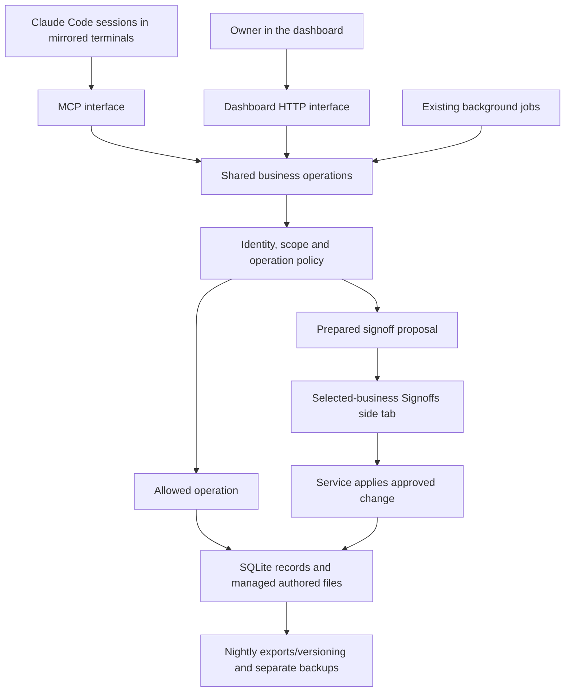

# Architecture

One shared application serves the dashboard and Claude Code and Codex agents. See
[domain APIs](../../DOMAIN-APIS.md) and the [v1.2 contracts](../v1.2/CONTRACTS.md) for the
companion contracts for storage, permissions and context delivery.

## One application, two interactive interfaces

MCP is a transport, not the application's business logic or storage layer. The
dashboard and MCP adapters reach the same operation implementations and
permission checks. Long-running background work may use managed subprocesses,
but there is one shared service and no MCP server or model runner per agent.

The application supplies Claude with tools; it does not replace Claude Code's
conversation loop. tmux shells and terminal mirroring remain the interactive
runtime. Background DeepSeek jobs are explicitly named workloads such as filing
or extraction, not members of the business-agent roster.

## Four independent concepts

| Concept | Example | Meaning |
| --- | --- | --- |
| Role | `business-agent` | The job, default operations and short essential instructions. |
| Plugin | Scoped email | Additional registered tools, procedures and target data. |
| Scope | One business, or explicit Ordubashy authority | Which records/resources the caller may operate on. |
| Permission mode | `allow`, `signoff`, `deny` | Whether a particular operation executes, requires a prepared review, or is refused. |

A role does not imply every plugin. A plugin does not widen business scope.
A task does not change either. An approved policy change is an ordinary managed
configuration operation evaluated under the current policy until it applies.

The role/profile model does not require inheritance from the organization chart.
Ordubashy and the business agent have different roles and scopes. They receive selected
applicable instructions rather than one generic restrictive prompt followed by
exceptions. Shared ancestor instructions contain only universally applicable
orientation.

## Explicit context delivery

At startup, resume, clear and compaction, the prepared agent's bootstrap resolves
one effective profile. It supplies identity, a short foundation, role brief,
business orientation where applicable, team/queue orientation and a compact list
of available abilities. Mandatory context is kept within a measured budget.

Detailed role/plugin procedures are selected project skills. Only granted
plugins are projected. Discoverability is not proof that a skill body has been
loaded; essential instructions do not depend on that happening. Tool access is
enforced independently by the service even when the session contains stale
descriptions or already-read instructions.

The existing extended context tree remains readable and filed by existing
workflows. A new search/retrieval service is explicitly not needed to complete
this foundation. The new architecture leaves an operation-registration path for
adding it later.

## Storage and ownership

SQLite owns operational state: identities, profiles, permissions, task records,
signoffs, requests, routine state and learning decisions.
Documents that people or agents author remain files where that representation
is useful: business context, role/skill text, plans, notes, source code and
assets. The database holds references/revisions rather than a second editable
copy of those documents.

Profiles select published role/plugin revisions. Generated Claude integration
files and exported `agent.yaml`/`business.yaml` are projections, never parallel
configuration sources that the server silently merges back in.

The service enforces protected mutations and checks file hashes/revisions before
applying them. Generated Claude project settings discourage direct protected
edits. This is application-level control, not strong isolation from a process
with unrestricted access under the same operating-system account.

Operational changes are durable when the application accepts them; nightly Git
commits are versioning/export work. Database backup and restore are separate.
No operation has to wait for Git push to become true.

## Signoffs and tasks

A signoff stores the prepared operation, its exact preview, current target
revisions and outcome. The owner approves or rejects inline in the existing
right panel for the selected business or Global. Approval discards draft feedback and
applies automatically. Rejection stores feedback for the agent. No signoff
creation/decision/application event is appended to the business journal.

An ordinary task asks an agent or the owner to do work or answer a question.
Agents see their business's roster and teammates' tasks/plans/notes, and can
assign tasks to themselves, teammates or the owner. Tasks queue work without
waking agents. Links can connect a task and a proposal, but approving a proposal
does not automatically complete an unrelated task.

New global/shared operations are reviewed in Global; business operations are
reviewed in their owning business. The server derives this destination, with
affected scope clearly identified. Older prepared proposals retain their saved
queue. Global also hosts authorized root agents/routines and the owner's personal
taskbox; it is not a synthetic business or a cross-business authority grant.

## Deliberate limits

- No new agent runner, waking logic or chat orchestration.
- No human-facing CLI requirement.
- No extended-context search project, semantic retrieval or vector database.
- No general cross-business operational dashboard beyond the existing Global views.
- No bespoke policy language, general workflow engine or plugin marketplace.
- No strict filesystem sandbox or personal Claude configuration overhaul.

Success is a coherent shared application with explicit agent configuration,
selective tools/skills, reviewable internal changes and reliable existing
business workflows. It is not measured by how much source code is replaced.
