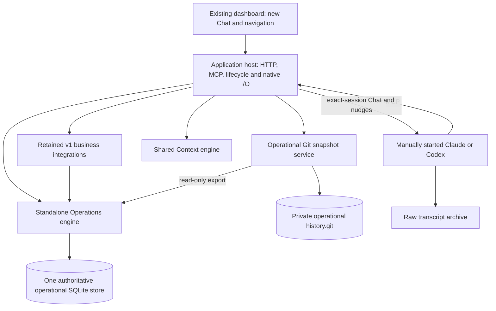

# Engine and host architecture

The structure is a separate Operations engine, a host composition, separate code/roles/operations areas, and operational Git history. The [behavior contracts](CONTRACTS.md) apply.

## Intended result

One application host composes one Operations engine, one Context engine and the retained v1 domain integrations. The Operations engine combines v1's proven authority/transaction/Signoff/routine machinery with the selected new Task/Action/thread/inbox behavior. The host adopts v2.2's explicit lifecycle, native-session and history composition, while retaining v1's transport identity and required application surfaces.

There is no second operational database, proxy to the old running application, alternate policy evaluator or old/new domain selector. An interface between permanent components is not a transitional compatibility service.

The diagram shows ownership, not separate processes. Engines are libraries composed by the host. A SQLite sidecar owned by Context or an existing browser service is technical state for that engine, not another operational authority.

## Responsibility matrix

| Responsibility | Final owner | Source strategy |
| --- | --- | --- |
| Principal IDs, memberships, registered agents, business namespaces and role-policy evaluation | Operations | Extract/adapt v1; do not install the donor's all-global catalog or tag-derived scope |
| Database units of work, typed repositories, revision checks, idempotency and prepared application | Operations | Preserve v1 semantics and exact reviewed-plan/recovery bindings |
| Task/Action state, revisions, tags and canonical item discussion | Operations | Adapt selected v2.2 implementation to v1 identity, one owning scope and prepared application |
| DM privacy, follows, inbox events/acknowledgment and nudge eligibility | Operations | New durable mechanisms with retained recipients and role contact rules |
| Native session detection, input arbitration, provider adapters and transcript capture | Host | Adapt v2.2 native mechanisms and preserve existing lifecycle/control authority |
| Chat reply identity/completion indexing, read positions and owner notification projection | Host, with declared metadata in Operations | Derive content from raw bytes; preserve durable identity/read state, attention acknowledgments and business `nav_only` behavior |
| Signoff decisions, frozen plans, application/retry and domain-independent input/notification rules | Operations | Move the v1 implementation; preserve behavior |
| Routine definitions, schedule/slot state, jobs, worker authority, costs and recovery transitions | Operations | Move the v1 registered-program implementation; preserve behavior |
| Actual routine computation and external integrations | Host/retained domains | Register existing trusted program definitions and callbacks; no arbitrary script execution |
| Context input ordering and immutable Action-source envelopes | Operations | Adapt v2.2 queue persistence and integrate with the same transaction |
| Model calls, pending-input reconciliation and Context publication | Host + Context engine | Host drives the pinned Context library outside operational transactions |
| Context upload/job completion | Operations receipts + host document/program integration | Exact source/job/input/event/commit bindings; declared worker outputs settle uploads/jobs after verified publication |
| Role package source loading, plugin handlers and generated workspace files | Host | Preserve v1 package/grant/adoption semantics; supply verified definitions to Operations |
| Neutral item lookup and typed relationships | Operations, with registered domain resolvers | Extract from Story ownership; extensions enforce the same authorization |
| Documents, tables, products, email, browser integrations, accounting, learning and other retained business features | Retained domains in the host source | Keep current behavior; use Operations contracts directly |
| HTTP/MCP identity, route registration, dashboard assets and lifecycle | Host | Recompose one service using retained v1 identity and API contracts |
| Operational row export | Operations plus explicit registered domain exporters | One consistent read snapshot, a declared table/column coverage contract |
| Git/file capture and history scheduling/status | Host | Adapt v2.2 history; see [history design](HISTORY.md) |

“Host” does not mean importing every domain implementation into one giant startup function. Composition assembles named modules and explicit services; it does not own duplicate implementations of their policies or records.

## Engine extraction boundaries

The new package is `qorqut_operations`. It must import without the application package, dashboard, provider CLI, role checkout, filesystem instance, network access or import-time initialization. It may depend on ordinary libraries required by the preserved engine; v2.2's current zero-runtime-dependency claim is not a v1.2 requirement.

The starting source inventory is below. Split files by responsibility when a current file mixes concerns; do not move an entire directory merely because its name sounds operational.

| Existing v1 source | Planned destination/treatment |
| --- | --- |
| `qorqut/contracts.py`, `application/{engine,registry,ports,batches}.py` | Operations contracts and application machinery |
| `application/catalog.py` | Engine-owned definitions in Operations; domain-specific registrations supplied by host composition |
| `storage/{database,repositories,receipts,files}.py` | Operations storage and generic prepared file execution; host supplies registered target resolution |
| `policy/resolver.py` | Operations policy logic; domain-specific defaults/restrictions become trusted registered policy contributions |
| `agents` identity/profile/membership and effective-grant calculation | Operations; separate actual package loading, browser helpers and native lifecycle into host adapters |
| `domains/tasks`, canonical `domains/activity` behavior, neutral `relationships` | Operations target Task/Action/relationship model |
| `inbox` records, recipients, subscriptions and private conversation identity | Operations; presentation/transport wiring remains host-owned |
| `signoffs` | Generic v1 lifecycle into Operations; platform-specific presentation/execution integrations stay domain-owned |
| `background/{programs,authority,routines,schedule,service}` and routine domain operations | Operations definitions/state/authority; host invokes retained execution/lifecycle boundaries |
| `background` concrete email/metrics/report/Context/learning handlers, `models.ModelCalls` and `repository.status` | Host/retained domains, registering typed programs against Operations |
| `service`, `transport`, terminal/native/provider/bootstrap I/O | Host, recomposed around the extracted library and selected v2.2 adapters |
| `domains` unrelated to selected changes | Retained host-domain modules; update imports, paths, item references and changed contracts only |
| Existing document/table history and recovery metadata | Preserve their domain contracts, split storage versus host I/O explicitly; do not replace them with periodic snapshots |

The final tree has one implementation of each moved module. Update current callers to `qorqut_operations` directly and remove the old active implementation/import path. Do not maintain a `qorqut.application` re-export layer or `v1_*` engine beside the new one to keep stale imports working. Retained host modules can keep their existing Python namespace; renaming unrelated domain code is unnecessary.

## Concrete coupling that must be removed

These are observed source dependencies, not hypothetical risks:

1. **Story-owned item infrastructure.** `domains/__init__.py` constructs Stories and attaches it to Tasks, documents, assets, tables and uploads. `ContextItems` and Focus reach shared lookups through that service. Move neutral item/relationship ownership first; final Story removal follows parent Task replacement.
2. **Policy imports business logic.** `policy/resolver.py` imports email defaults and role-specific rules. Extract generic policy evaluation without dropping those restrictions. Supply an immutable, allowlisted set of domain policy contributions at assembly; they cannot override hard owner-only decisions or be provided by an API caller.
3. **Signoffs import platform/Story presentation.** The service imports platform proposal summaries and campaign filtering. Use typed domain presentation/filter/application contributions while keeping the owner decision, prepared-plan, revision and recovery logic in Operations. A display hook cannot authorize an operation or manufacture a reviewed target.
4. **Storage knows all tables and document history.** The repository catalog and mutation/history hooks currently include both operational and business-domain tables. Use a composed, frozen schema/repository catalog and explicit transaction hooks; do not blindly move every business feature into Operations or silently omit its history hook.
5. **Background registration mixes schedule and implementations.** Preserve program IDs, definition digests, declared outputs, worker grants and recovery semantics. Register concrete callbacks from the host; moving their file paths must not accidentally change a program's semantic definition/digest.
6. **The host has many retained services.** Current `Runtime` includes browser/sandbox, broadcasts, owner reminders, Telegram, private conversations, change feeds, previews and more. The new host must account for every installed service; importing the smaller v2.2 `Backend` alone would lose functionality.
7. **Path derivation is distributed.** Service startup, dashboard launchers, package source resolution, agent preparation, native hooks and table/document history use old roots. All use the explicit instance paths (`qorqut/instance_paths.py`) after the restructure.

Before extraction, create an implementation ledger with source module/symbol, target owner, policy/scope requirements, schema dependencies, background effects, history treatment, focused check and deletion/update status. Include each registration from the current composition root; an unclassified entry prevents marking the host complete.

## One database and transaction contract

Use the preserved v1 storage/application semantics as the foundation of the v1.2 Operations package. Adapt the donor's record functions to that unit of work. Do not expose both the donor `Database/Actor` model and v1 `Application/InvocationContext` as separate authorities.

Required invariants:

- One exact registered principal and owning namespace accompany a mutation. `global` means its own namespace, not a wildcard or an absent permission check.
- Keep v1's canonical operation/input, principal, namespace, idempotency and exact prepared-plan bindings. Reusing a key with different scope or arguments remains a conflict.
- The same transaction commits the record/revision, mandatory operational events, inbox fanout state and Action Context-input envelope where applicable. External provider, Git and network work happen after commit.
- Existing retained producers and new producers have one agreed event identity. Inventory old SQL triggers and callbacks to prevent duplicate fanout after new finalizers are installed.
- Read-only units cannot mutate. Revision conflicts, revocation, busy outcomes and uncertain effects retain their explicit meanings.
- Build the target schema and trusted extension catalog once before opening service traffic. Each table, index, trigger, repository, event hook and history exporter has one owner; duplicate or missing registrations fail clearly.
- Freezing operation/schema definitions does not freeze principal memberships, role adoption, overrides or current grants. Their revisions and authority are still refreshed at the same execution boundaries as v1, including approval application and retry.
- Retained domains use the same unit of work. There is no auxiliary v1 database hidden behind a permanent “adapter.”

Context publication is a separate Git commit boundary. Operations records its verified outcome and a pending completion receipt atomically, then the registered program applies that result through its declared authorized output. An enqueue receipt is not a publication or upload-completion receipt. The [completion contract](CONTRACTS.md#context-completion-for-uploads-and-registered-jobs) specifies revision races, deferred jobs and each recovery gap without pretending Git and SQLite share a transaction.

Prepare a target schema for isolated empty test instances. Do not run historical upgrade chains, inspect real rows for compatibility, fabricate owner/agent registrations, or accept the live v1 database merely because the source was forked from it. Serving validates an already initialized target instance; it never creates or converts one implicitly.

## Preserving Signoffs and routines while relocating them

Preserving behavior permits moving code and replacing dependencies. It does not permit replacing the implementation with superficially similar v2.2 behavior.

For Signoffs, carry the current owner review restrictions, proposal/payload/status revisions, exact prepared operation, automatic approved-plan application, current-authority checks, file receipts/claims, rejection/input workflow, notifications and explicit retry semantics. Any platform-specific effects still run through their registered owning domain. Neither native nudges nor generic thread posting acquire review authority.

For routines, carry registered-program dispatch, schedule/timezone and DST handling, global serialization, missed-slot coalescing, manual-run semantics, worker definition/grant binding, costs, stop boundaries and recovery. A Context handler changes because Context is selected for replacement; ordinary program behavior remains. The host owns service/executor lifetime but must preserve the existing serialization and cancellation boundaries.

Use one generic file executor and trusted resource-to-target resolver. Preserve before/after hashes, current authority, partial-effect receipts and claims. Relocation cannot introduce a second direct file writer or resolve an arbitrary caller-provided path. Existing quiescence/admission/recovery controls must be assigned owners and preserved; data recovery itself is not being executed or redesigned here.

## Host composition and lifecycle

The host is the application under `qorqut-code/app/`. It adopts explicit v2.2 assembly and independent native/Context/history drivers, incorporates retained v1 service functionality, and remains the sole HTTP/MCP process. It is not a proxy in front of the old server.

Assembly is inert: validate configuration, construct services, register schemas/operations/domain providers, and resolve dependencies. It does not create data, start agents, schedule work or call models.

Startup sequence:

1. Validate explicit instance/component paths, target schema/instance marker and endpoint configuration; acquire the backend's instance lock.
2. Load the current registered owner/agent identity and trusted role/program definitions. Preserve existing HTTP identity, MCP credential/principal binding and scope validation. Adopting the new host does **not** adopt v2.2's no-login assumption.
3. Complete required prepared-effect reconciliation/admission checks before allowing conflicting mutation traffic. Unknown effects retain claims and truthful status.
4. Start the retained Signoff application and routine/job services, then independent native observation/delivery, Context, transcript capture, change-feed and history work under one lifecycle registry. Preserve retained service dependencies rather than relying on constructor side effects.
5. Expose liveness separately from component readiness. A failed Git snapshot or blocked Context input does not disable ordinary Tasks/Chat; unsafe storage/authority prevents mutations.

Shutdown stops new work, drains/fences writers and callbacks, awaits their final receipts, and closes SQLite last. A bounded drain timeout is reported as unfinished work, not successful completion. Existing terminals/provider conversations are not killed as a side effect of stopping the backend.

Each retained service needs an entry recording registration, startup prerequisites, worker/executor owner, stop/drain behavior, failure visibility and path roots. This replaces the current sprawling composition without losing its services.

Existing maintenance/recovery source is included in that inventory. Retarget its component paths and new-Context snapshot dependencies where required; do not leave the removed Context engine installed solely to satisfy stale imports or silently disable a registered program. This preserves an existing capability and does not authorize taking backups, restoring data or running maintenance for the port.

## Required permanent interfaces

Freeze these before parallel feature work:

| Interface | Responsibility |
| --- | --- |
| Invocation/authority | Trusted principal, selected owning scope, role/grant revision, worker/program attribution and current policy |
| Schema/operation registration | Explicit trusted definitions, one unit of work, unique ownership, immutable assembly after startup |
| Item and relationship resolver | Scope-aware identity/revision/summary for engine and retained domain items; no permission bypass through linked records |
| Prepared file target | Trusted resource mapping, expected bytes/revisions and durable application receipts |
| Program registration/execution | Typed immutable program definition and output permissions; host callback and bounded recovery controls |
| Inbox/native delivery | Event coverage and exact session generation; application origin/type separate from provider message roles |
| Chat archive/identity/read state | Append-only raw bytes and captured-prefix receipts; durable reply/completion IDs, read cursors and independent owner notification acknowledgments; no second content authority |
| Context driver and completion | Immutable ordered source revision, upload/job/input binding, verified event/commit and idempotent authorized completion; external calls outside SQL transactions |
| Retained field/API contracts | Explicit Task fields/configuration and Context home/edit/cost DTOs, caller mappings and acceptance checks before ports |
| Paths/component locations | Explicit code, roles, operations, business and registered-agent roots; no current-working-directory inference |
| History export | Versioned table/column coverage and stable keys from one read unit; private/sensitive exclusions explicit |

These are direct interfaces in the final application, not translation between two live formats. Record exact arguments/results and owning repo in the implementation contracts; avoid building a general plugin framework when a small typed callback suffices.

## Architecture completion evidence

Before calling the extraction complete, show a small vertical slice from an installed host through the installed Operations package: a synthetic business agent proposes a protected mutation, the owner approves it, the v1 executor applies the exact plan, an inbox event is available, and the history exporter reads the committed outcome. A separate registered routine proves current scheduling/authority. Use injected external boundaries, no live records or provider sessions.

An installed-package check must run outside source trees with no old-checkout `PYTHONPATH` or `sys.path` fallback. It must prove Operations imports without the host, the host composes both engines, and a retained business-domain operation still works. This catches accidental success caused by the old monolith remaining on the developer path.

S2/S3 also carry representative retained Task-field and notification metadata contracts, and demonstrate a deferring registered program releasing execution before later authorized result application. P2/P3/P4 implement their final selected behavior only after that installed composition proof; the added contracts do not change the dependency order.

This architecture is source description: it authorizes no data relocation, migration, role adoption or live release.
