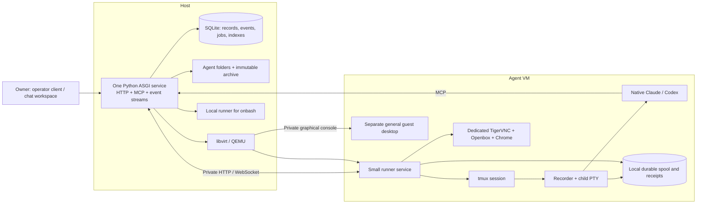

# Backend architecture

Status: planned. Shared IDs, states and operation names are defined in [CONTRACTS.md](CONTRACTS.md).

## 1. Process model



The host service owns application decisions. The runner owns local process observations and durable execution/capture receipts. The recorder is a small process inside tmux, independent of the runner service's lifetime. It records native CLI output before forwarding it to the visible terminal and tails all sources registered for that run.

Host application restarts do not restart libvirt domains, runner services, tmux sessions, recorders or Chrome. Runner-service restarts do not terminate the recorder or native CLI. VM reboot is an actual process loss and must be recorded as such; persistent disks do not preserve a running tmux process across reboot.

Use a single ASGI worker process in v1. It runs a bounded set of supervised loops for durable jobs, reconciliation, host collection from runner spools, normalization and freshness transitions. Long I/O never holds a SQLite transaction. Blocking SQLite/libvirt work runs outside the request event loop. Background work has persisted cursors and retry state; a Python task object is not durable work.

Place each agent's managed tmux/recorder/CLI and desktop in independently supervised systemd runtime units/cgroups, outside the host and runner service cgroups, with no restart coupling to those services. Use an agent-owned tmux socket so unrelated sessions never share that runtime unit. Daemonizing tmux alone does not provide this isolation. Stop/pause operations address the owned runtime tree, including detached descendants. These are local process-supervision units, not extra application services or registries.

## 2. Source package boundaries

Proposed package tree, to create as modules are implemented:

```text
src/qorqutbot/
  app.py                 composition and service lifecycle
  config.py              installation configuration
  contracts.py           shared typed values and errors
  storage/               migrations, transactions, events, jobs, receipts
  agents/                registry, status, activity, folder lifecycle
  environments/          libvirt driver and host target
  runner/                small control service, process bindings, tmux, receipts
  adapters/              Claude, Codex and terminal-only capability
  messaging/             threads, messages, attempts, handling receipts
  browser/               desktop supervisor, automation, human control
  transcripts/           recorder, spool, transfer, archive, parsers, FTS
  continuity/            checkpoints, packets, resume/switch orchestration
  files/                 workspace access and portable exports
  transport/             HTTP, MCP, events, terminal/desktop proxies
  ops/                   init, migrations, backup, restore, diagnostics
web/                     single-page chat workspace plus pinned viewer assets
images/                  reproducible guest image recipe, not disk artifacts
tests/                   unit, contract, process, VM and acceptance groups
```

These are code boundaries within one distribution. Avoid a separate service or public abstraction for each directory. The runner can be installed from the same wheel with a different entrypoint. Only import the libraries needed by that entrypoint; guest execution should not need the host's libvirt bindings.

## 3. Data ownership and folder layout

The configured data root is independent of the source checkout and release directory:

```text
<data-root>/
  installation.json                    installation ID and static paths/config
  state.sqlite3                       host operational authority
  images/<image-digest>/base.qcow2     immutable shared dependency
  locks/                              host-local process locks
  agents/<agent-id>/
    agent.json                        recoverable identity/config projection
    workspace/                        virtiofs mount in VM; direct cwd for host
      AGENTS.md                       generated small entrypoint
      CLAUDE.md                       generated adapter entrypoint
      instructions.md                 authored agent instructions
      memory.md                       authored current handoff/checkpoint
      notes/
      research/
      files/
      downloads/
      scratch/
      .qorqut/generated/              prepared immutable/versioned inputs
    history/
      sources/                        reconstructable source manifests
      chunks/                         immutable raw transcript objects
      attachments/                    captured referenced assets
      context-packets/                exact restoration packets and provenance
    runtime/
      credentials/                    registration and runner identities
      vm/root-g<generation>.qcow2     boot overlay over pinned image
      vm/state.qcow2                  independent persistent ext4 state disk
      vm/domain.xml                   generated definition/provenance
      home/                          host-mode HOME only
      spool.sqlite3                  host-mode runner/recorder state only
    exports/                          requested portable bundles/manifests
  backups/                            installation/archival backup manifests
```

Do not create a second canonical mutable configuration store in `agent.json`. SQLite is authoritative for display name/icon key, desired state, configuration revisions and coordination. The file is a versioned recovery/export projection containing agent ID, layout version, config revision and relevant pins. Reconciliation repairs stale projections from committed records. An imported folder needs an explicit import manifest; directory discovery never silently registers it as a new agent.

The agent folder is the unit of owned filesystem data. Full portability also requires the agent's slice of central records, included by export. Merely copying `agents/<id>` while the database is live is not a complete operational export.

### VM storage

Each VM has:

- A persistent writable root overlay over an immutable pinned base image.
- A separate ext4 state disk mounted by filesystem UUID at `/var/lib/qorqut-agent-data`.
- Persistent `home/` from that disk bound to `/home/agent`.
- Runner receipts and recorder spool on that state disk.
- Only its authored host workspace shared through virtiofs at `/workspace`.

Native CLI authentication/state and Chrome profile SQLite files stay on guest-local ext4. Chrome's profile is `/home/agent/.local/share/qorqut/chrome`; downloads go to `/workspace/downloads`. Do not place a running profile or native CLI store on virtiofs, NFS or a copied host personal directory.

Readiness fails if the intended state disk or workspace mount is absent. Never silently create an empty temporary HOME or workspace and start a new browser against it. Ordinary reboot preserves both root overlay and state disk. Explicit image replacement creates a fresh root overlay and retains the state disk through a tested upgrade path; it does not silently preserve arbitrary system packages installed into the old overlay.

### Host-global onbash

Onbash uses the same agent folder, recorder, CLI adapters, message contracts and history, with `environment.kind=host`. It has its own HOME, tmux session and Chrome profile. Its dedicated Chrome display and separate general desktop use distinct host display/VNC bindings allocated once and persisted, since the host has no VM port namespace. It does not reuse the existing Qorqut or owner desktop.

The host executor selects local operations; an unreachable VM is never converted to a host executor. Onbash has host access as requested. Per-agent VM separation and an unrestricted control API are not an adversarial multi-tenant security boundary.

## 4. Network and transport

Use one installation-owned libvirt NAT network in v1. Persist its non-conflicting subnet, bridge address and DNS configuration. Give each domain a stable UUID, MAC and DHCP reservation; every guest can use the same internal service ports:

| Endpoint | Location | Purpose |
| --- | --- | --- |
| Runner HTTP/WS `8091` | Guest private interface | Host control, receipts, transcript transfer and proxies |
| VNC `5901` | Guest loopback only | Dedicated Chrome application desktop |
| Libvirt graphical VNC | Private host Unix socket per VM | Separate general machine desktop; no public console port |
| Chrome CDP `9222` | Guest loopback only | Browser automation |
| Host HTTP/MCP | Configured host/bridge addresses | Owner console/API and agent MCP |

The host finds a guest through its recorded domain/network reservation, then verifies the runner's agent ID, environment generation, boot ID and protocol. An IP address is a route, not identity.

Bind private host/guest requests using per-agent transport credentials. Bind CLI MCP requests to their registered actor identity. Identity checks supply attribution and prevent misrouting; they do not authorize different operation sets. Every registered actor receives the same v1 domain operations. Keep guest transport credentials out of browser JavaScript and command-line logs.

Use ordinary HTTP request/response and WebSockets with versioned envelopes, bounded bodies and cursors. No custom multiplexing protocol, service mesh or per-agent public host-port range is required. External access, if configured, terminates TLS at the host service or a conventional reverse proxy; never publish guest CDP or VNC directly. The private single-host trust assumptions and exact listen addresses must be explicit in installation config.

### Desktop and terminal viewers

Serve pinned noVNC and a small terminal emulator from the host. Browser viewing goes through the authenticated host proxy/runner to that agent's dedicated TigerVNC Chrome display. Machine viewing targets its separate guest graphical console (private libvirt VNC with a usable general desktop), or onbash's separate local desktop. `surfaces_list` and surface IDs keep these bindings explicit. A terminal connection attaches to existing registered tmux through the runner. Opening, closing or reconnecting viewers does not start/kill agents.

The single-page UI has agent navigation, central chat and a collapsible inspector. A browser-request card is full-width and directly interactive once human control is ready; expansion uses the same viewer/surface. Reuse one UI viewer instance across inline/modal/inspector to avoid duplicate input owners or competing display resizes. Machine takeover coordinates the existing terminal/browser gates. See [UI-PLAN.md](UI-PLAN.md) for layout, twenty icons, inline rename, file cards and monochrome styling.

Manual terminal input and automated paste share a per-run input lock. `terminal_control` takes or releases control with an exact run binding and a monotonically increasing control epoch. A disconnected input viewer leaves human mode in place until explicit release or takeover; there is no automatic expiry in v1. Stale same-run viewer epochs cannot type. The composer is rechecked before automation resumes without clearing human text. A viewer that only observes does not take control.

## 5. Authority and durable effects

| Concern | Authority | Recoverable derivative |
| --- | --- | --- |
| Agent identity/config/current state | Host SQLite | `agent.json`, directory/API responses |
| Status/state/creation/message history | Host SQLite append-only events and message records | UI lists, exports |
| Authored notes/research/files/memory | Agent workspace files | File listings, hashes, exports |
| CLI/VM/browser processes | Actual inspected process/domain plus generation-bound observations | Current rows and UI state |
| Locally captured, not yet archived bytes | Runner/recorder spool | Host-pulled transfer batches |
| Host-acknowledged transcript bytes | Immutable host chunk files + committed inventory | Parser records, conversation, FTS |
| Context sent to a replacement CLI | Saved context packet + delivery receipt | Startup summary |
| Browser/file cards | M06 request or M09 file-reference record plus conversation entry ledger | Inline cards, attention indicators, optional transient toast |

Use current tables plus an append-only event journal, not a general event-sourcing framework. Record a mutation, its event, operation receipt and required durable job in one transaction. Events preserve old/new status text and relevant state, actor, target IDs and timestamps. Unchanged heartbeats do not append status-change events.

Filesystem and process effects occur outside the SQL transaction using explicit receipts. Their workers reconcile the exact saved target/generation after a crash. A database lease only fences database ownership; a host-local lock held throughout a libvirt effect prevents an expired worker from continuing to mutate a VM while another begins.

Lifecycle intent has its own revision. Archive closes launch admission and invalidates queued start/restart/switch intent under the same per-agent lifecycle lock; effects already in progress are settled and then stopped. Jobs check current intent before acting. `runtime_stop` stops only the managed CLI, preserving the environment/browser; archive stops the agent's whole managed execution environment. Only explicit restore reopens an archived identity, with no automatic model start by default.

Input delivery is a special external effect. Record intent before paste. An attempt that might have pasted or pressed Enter becomes uncertain until evidence resolves it; there is no automatic second paste. Submitted input and semantically handled work have different receipts.

## 6. End-to-end flows

### Create and start

1. `agents_create` commits UUID, config, initial status, creation event and provisioning job under one idempotency key.
2. The job establishes the owned folder and projections, provisions the selected environment and checks runner/mount readiness.
3. If start was requested, a new run/generation is registered before launch. Preparation writes only generated inputs; authored files survive.
4. The recorder and native CLI launch together. Hooks/registering sources bind exact native identities to the run.
5. Capture readiness and native readiness are exposed independently. Missing login or trust input produces an explicit setup condition; it is not reported as a working agent.

### Message another agent

1. Sending commits the complete attributed message, thread link and pending delivery.
2. Delivery waits for a capture-ready, correctly bound runtime and an available input composer.
3. The runner serializes a bracketed paste/Enter and returns a durable outcome. The host saves the outcome.
4. The recipient reads/acknowledges exact message IDs. Reads and replies do not acknowledge the parent automatically.
5. If the recipient is offline, the message remains queued. Starting it is a separate recorded action, not an implicit side effect of reading messages.

### Human browser input

1. Resolve the calling agent's browser from an intent-only tool call; atomically record request, conversation entry/event and transition to human control.
2. Wait for any in-flight managed browser command to settle; only then report that human control is ready.
3. The chat renders an inline interactive viewer of that same dedicated Chrome/profile, with a top-right modal expansion. Input is enabled after control is ready.
4. Done completes the exact request, advances control epoch, records the answer and queues one attributed completion message in the same host transaction.
5. Reconcile the new control epoch with the runner before admitting automation. The agent observes the page again; Done is not proof of successful login.

### Reference a file

Resolve the supplied path inside the selected agent workspace/environment, inspect its metadata, and atomically save the reference and conversation entry. The chat shows one persistent file chip with copy-path access; direct opening/preview is deferred. Event replay/native transcript parsing updates the same card rather than calling the tool again. Referencing does not create an implicit content snapshot or claim the user viewed it.

### Provider switch

Freeze new automated delivery, reach/choose a stop boundary, drain known sources, stop the old run and verify exit, and finalize capture evidence. For a context packet, wait for parsing through the selected raw checkpoint and snapshot exact memory/artifact bytes; otherwise choose verified native resume. Prepare and launch the replacement, verify capture/native readiness and the selected restoration outcome, then release queued messages. Native resume does not add another automatic startup prompt. Reuse the VM, browser profile and agent ID. Failure leaves a persisted recoverable operation, not a hidden rollback to a different model.

## 7. Backup and failure boundaries

An online **archive backup** can snapshot host SQLite and copy the immutable chunks referenced by that snapshot while new capture continues. There is no automatic archive deletion, so this inventory remains valid.

A **full agent or installation backup** includes live files, native stores and VM disks. V1 uses stopped backups: drain, quiesce all included writers, shut down included guests, verify stopped state, then copy disks/workspaces and a matching DB export. Do not copy live qcow2 images and claim application consistency. The backup records its actual recovery point and exact image dependencies.

Restore verifies hashes and identity before activation. A full-installation restore needs an inactive destination; a single-agent import needs an unoccupied agent identity and a consistent central-record merge. A new recovery epoch and reissued credentials fence old control. Restored unfinished external-effect jobs/deliveries remain held for reconciliation because the original installation may have performed them after the backup. Missing receipts are not proof of no effect. Intentional clone creates a new current identity/provenance; v1 rejects cloning onbash into another host agent.

Disk pressure is a first-class health condition. Stop admitting new work before spool/archive exhaustion, and pause affected producer subtrees when needed while recorder/runner remain runnable. Keep already captured bytes; never rotate away the oldest transcript to make progress. See M07/M11 for thresholds and fault tests.
