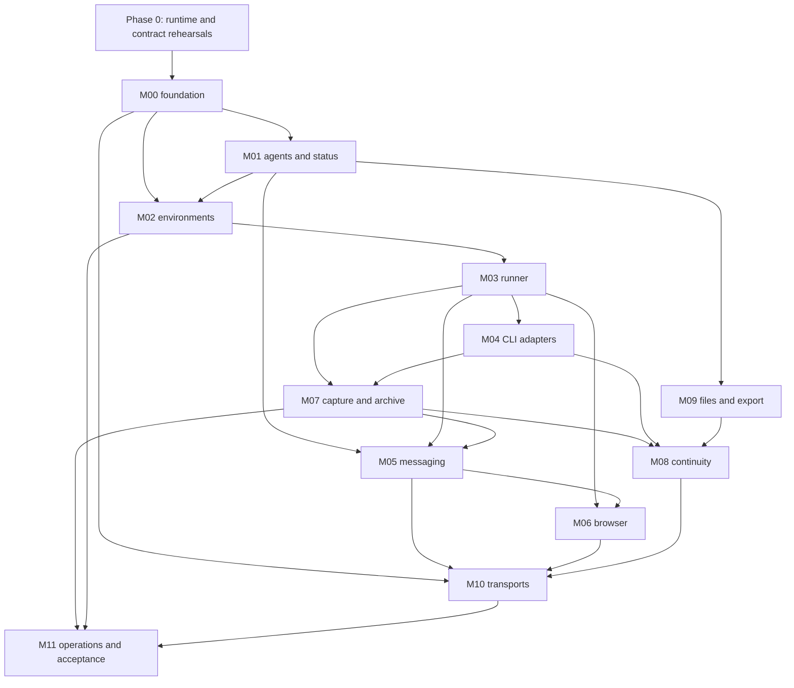

# Qorqutbot backend implementation plan

Status: planning baseline, 2026-10-07. No runtime implementation or deployment is part of this commit.

## 1. Product contract

Qorqutbot hosts persistent agents. A logical agent owns its identity, files, notes, research, browser profile and accumulated history independently of the currently selected CLI, model, native conversation or VM process. Agents work in interactive tmux-backed terminals and coordinate through Qorqut MCP. The owner can create agents, inspect them and intervene in their browsers. Agents can create and contact other agents themselves.

The owner values lean code and high quality, with no deadline-driven reason to weaken correctness. The plan therefore minimizes deployed components and duplicated concepts, while investing heavily in explicit contracts, selective extraction, failure tests and recovery rehearsal.

### Required v1 behavior

| Requirement | Concrete meaning | Primary modules |
| --- | --- | --- |
| R01 Stable agents | Immutable UUID, editable name, dedicated `agents/<UUID>` folder; IDs survive all ordinary runtime changes | M01, M09 |
| R02 Create from either actor | Owner and agents call the same create operation; creation/provisioning/start have inspectable progress and permanent creation history | M00–M04, M10 |
| R03 Per-agent environment | Each ordinary agent has its own persistent Linux VM, workspace, native CLI stores and desktop | M02, M03 |
| R04 Host-global onbash | Exactly one reserved global host agent; same contracts and files, no VM | M01–M04 |
| R05 CLI/model independence | Claude and Codex initially; model choice belongs to configured CLI adapters rather than platform identity | M03, M04, M08 |
| R06 Persistent browsers | Dedicated Chrome profile per agent; browser control and human intervention; login state survives ordinary restart | M06 |
| R07 Durable coordination | Complete direct messages, threads, timestamps, sender/recipient identity, offline delivery and explicit handling receipts | M05 |
| R08 Advertised state | Every agent is discoverable with ID/name, current status, activity and freshness; status is at most 100 words | M01, M10 |
| R09 Permanent changes | Every changed status/state and every creation is recorded; message history does not expire | M00, M01, M05 |
| R10 Complete captured history | All supported native streams and terminal output are collected with visible health, durable retry and no whole-file ceiling | M03, M04, M07 |
| R11 Provider changes preserve work | Same agent and logical history; files/browser persist; new runtime receives the chosen restoration packet | M08, M09 |
| R12 Unrestricted v1 | No role grants, capability policies or signoff engine; caller identity and target validation remain | M00, M10 |
| R13 Minimal useful UI | Agent list, terminal, desktop and input-request completion; backend APIs cover the rest | M10 |
| R14 Recoverable operation | Restart, backup, restore, disk pressure and software upgrades have tested outcomes | M02, M07, M11 |

“Always collect” has a precise storage contract in [M07](modules/07-transcripts.md). Captured bytes must not silently disappear. Provider-internal data never emitted, a killed CLI's unflushed buffer, and physically lost storage without backup are outside an achievable collection guarantee. These limits are exposed as health/evidence, never concealed by claiming complete Chat.

## 2. Chosen shape

Build a modular Python application rather than carrying over the entire business platform:

1. One host ASGI application serves HTTP, Qorqut MCP, event streams and the small console.
2. One host SQLite database owns registration, coordination, state transitions, operation/job receipts and history indexes.
3. Each agent's host folder owns its authored workspace, immutable transcript archive and execution files/disks.
4. Each VM runs a small runner service. The host-global agent uses the same runner locally.
5. A recorder inside each managed tmux session wraps the native CLI. Independent systemd runtime units preserve it across runner-service restarts. It durably spools terminal/native bytes for the host collector to pull and acknowledge.
6. Each guest runs persistent Chrome and a VNC desktop. Browser commands run next to Chrome. The host proxies the viewer; there is no separate Guacamole deployment.

Use Python 3.12, stdlib SQLite, one validation model family, the official MCP SDK, Starlette/Uvicorn, tmux, QEMU/KVM/libvirt, virtiofs, Chrome, TigerVNC/Openbox, and a pinned `agent-browser` adapter. Exact package and image versions are pinned after compatibility rehearsals. No Redis, Kafka, external search engine, model SDK runner, multi-node scheduler, role catalog, general workflow engine or business schema is needed for v1.

The concrete architecture is in [ARCHITECTURE.md](ARCHITECTURE.md). Public names, states and ownership are in [CONTRACTS.md](CONTRACTS.md).

## 3. Planning defaults and decisions

The owner has been asked two preferences. This baseline proceeds with explicit defaults:

- **D02:** “Own VM” means a real QEMU/KVM Linux VM, not merely a container or separate VNC display.
- **D08:** A provider/client switch automatically restores a captured memory snapshot plus bounded relevant conversation context. Complete history remains available separately.

If the owner changes either preference, update the decision and affected module plans before implementing that dependency. Identity, message storage, raw archival and operation contracts are useful under either choice. No reply is treated as confirmation.

Other decisions are recorded in [DECISIONS.md](DECISIONS.md), including one active managed CLI per agent, independent raw history, host-pulled capture, explicit control epochs and lifecycle precedence. Full restore uses a new recovery epoch and holds unfinished external effects for reconciliation; uncertainty is never resolved by automatic replay.

## 4. Porting strategy

Qorqut is a source of working mechanisms and hard-earned failure behavior. Each extraction must have a named contract and a meaningful test before integration.

- **Extract narrowly:** tmux buffer paste/Enter, PTY mirroring, native process fingerprints, composer fixtures, browser adapter command translation, desktop shutdown/profile flushing, useful native record parsers.
- **Adapt deliberately:** per-client preparation and hooks, generation-bound sessions, message/outbox receipts, all-agent Chat projections, owner-Done/message atomicity.
- **Implement new:** agent-ID folder registry, durable status history, libvirt driver, guest protocol, recorder/spool/archive, all-source transcript registry, cross-client restoration.
- **Leave behind:** business IDs/namespaces, fixed business-agent/Dev roster, role/plugin policy, signoffs, marketing/task/Fleet workflows, business proxies, huge domain bootstrap, legacy snapshot ceilings and current-marker-only collection.

The [porting matrix](PORTING.md) names exact source commits, files, tests and acceptance changes. It does not authorize copying operational data or modifying Qorqut. The new repository must run without a sibling Qorqut checkout.

Do not begin by copying large modules and deleting code until tests pass. First identify the retained behavior, build its small destination API and fixtures, then extract or rewrite the minimum implementation. Preserve applicable source notices and record the origin of substantial adaptations.

## 5. Dependency and delivery order

The order is gate-based, not date-based. Unlimited development resources permit more independent review and better tests; they do not remove dependencies between durable contracts.

M10 starts early with a thin transport skeleton; its full acceptance waits for the domain modules. M11 contributes installation, fault-injection and supervision scaffolding from Phase 0; backup/release completion waits for the integrated system. Neither is postponed until the last week of development.

### Phase 0 — Prove the expensive assumptions

Deliver disposable technical rehearsals and decision records, not product scaffolding masquerading as a working platform.

1. Verify host prerequisites: hardware virtualization, libvirt access, QEMU, virtiofs, image tools, disk space and network overlap. The inspected machine has `/dev/kvm`, but this account lacked direct read/write access and QEMU/libvirt commands were not on PATH. No readiness claim follows from the device existing.
2. Boot two disposable guests with a shared immutable base, independent root overlays/state disks, separate virtiofs workspaces and one private NAT network.
3. Prove fixed-port guest HTTP/WS, bound identity, host MCP reachability, tmux reconnect/input and direct noVNC desktop proxying.
4. Prove Chrome cookie persistence and distinct profiles across browser restart and VM reboot with synthetic local sites.
5. Prove a nested-PTY recorder preserves CLI interaction, resize, Unicode, bracketed paste, signals and durable output ordering. Prove owned runtime cgroups survive actual runner-service restart and allow pausing producers while capture remains runnable. This is a go/no-go technical gate for the strong terminal recording contract.
6. Pin and rehearse Claude/Codex native source/hook/resume contracts using isolated fake provider endpoints where possible. Identify parent/child transcript stores and attachments.
7. Rehearse a stopped agent backup/restore and runner reconnect without an extra model turn.
8. Select dependency versions and record executable image/package hashes. Resolve D02/D08 changes if the owner supplied them.

**Gate G0:** both guest isolation and the recorder work under disposable tests; adapter evidence names exact versions; assumptions and unresolved limits are written down. No production agents or accounts are used.

### Phase 1 — Durable core and agent identity

Implement M00 and M01 with fake executors, and the thin M10 transport. Add the workspace layout from M09.

Deliver atomic operation receipts, event history, typed durable jobs, a stable agent registry, create/rename/archive, the reserved host onbash identity, status validation/history, explicit observed activity/freshness, and shared HTTP/MCP operation behavior.

**Gate G1:** concurrent/retried creation yields one ID and one creation event; changed statuses survive restart; 101-word text is rejected identically by every transport; no business or role-policy dependencies exist.

### Phase 2 — Persistent execution environments and terminals

Implement M02/M03 and core M04 preparation. Bring the proven recorder skeleton into managed launches immediately, even before rich history rendering.

Deliver one real VM per ordinary agent, the host executor, immutable image pins, persistent disks/home/workspace, authenticated runner identity, one active run per agent, tmux terminal streaming and serialized input receipts. Add explicit terminal take/release epochs and lifecycle intent fencing so stale viewers and queued starts cannot override control or archival. Surface “not ready” when mounts, credentials or native CLI setup are missing.

**Gate G2:** two agents and onbash run independent terminals; host service restart preserves live VM/tmux/browser processes; VM reboot is recorded as a different execution situation; stale commands cannot reach a replacement run; uncertain input never repeats automatically.

### Phase 3 — Continuous archive before autonomous operation

Complete M07 with both native adapters from M04. Add the required storage-pressure behavior from M11.

Deliver durable all-source registration, local transactional spooling, immutable host chunks with fsync-before-ACK, resumable transfer, explicit gaps, native children/attachments, rebuildable parsing and FTS search. Remove every dependency on a “current session file” being the only history source.

**Gate G3:** interruption at every chunk/cursor/file/DB/ACK boundary loses no acknowledged byte; transcripts larger than 8 MiB and giant records survive; host/runner outage and source changes preserve provenance; disk pressure never silently drops output. Until G3 passes, agents are test sessions, not an operational autonomous fleet.

### Phase 4 — Coordination and browser intervention

Complete M05/M06 and the operational portions of M10. Browser supervision can be developed in parallel with Phase 3, but unattended work waits for capture readiness.

Deliver direct messages and offline queues, guarded terminal delivery, semantic handling receipts, persistent browser control, VNC viewer, and browser input request/Done/Cancel transitions. Manual browser takeover reuses the same request state machine. All agents can discover and contact every agent, and can request creation using the same operation as the owner.

**Gate G4:** three agents can create/contact peers and preserve messages while recipients are offline; busy or human-controlled terminals defer without losing messages; browser takeover waits for in-flight commands and releases exactly once; same-site logins survive ordinary restart.

### Phase 5 — Provider switching and portable work

Complete M08/M09. Add native resume without duplicate startup input, deterministic context packets behind a raw/parsing checkpoint, retained memory/artifact snapshots, search/raw retrieval, stopped export/import and exact preservation checks.

**Gate G5:** Claude → Codex → Claude preserves agent UUID, workspace, browser profile, full captured history and pending messages. Each new run has a recorded restoration packet or verified native resume. A failed target launch remains visible and recoverable without silently replaying uncertain input.

### Phase 6 — Operational acceptance and first deployable release

Complete M11 and run the [acceptance matrix](ACCEPTANCE.md). Package installation, systemd units, pinned guest image, migrations, diagnostics and rollback instructions.

Exercise full-installation stopped backup/restore under a different data root, archive-only online snapshot, SQLite integrity/reindexing, daemon/guest/CLI restarts, network interruption, capacity pressure, browser handoffs and CLI version mismatch. Include onbash's runner spool/receipts, exact disk backing dependencies and restored-work reconciliation so backup activation cannot repeat post-snapshot effects. Measure observed capacity and set conservative defaults from the results.

**Gate G6:** a fresh host can install the pinned release and restore a backup without Qorqut present; all critical invariants have passing evidence; known limitations are accurate. A real provider smoke test verifies actual CLI behavior using new disposable agent identities. Source/fixture success alone does not satisfy live acceptance.

## 6. Implementation work packages

Each module plan contains its own implementation sequence, interfaces, extraction decision, failure behavior and definition of done. Each change should land as a coherent reviewable package:

1. Contract/schema plus focused tests.
2. Small implementation with fake external boundaries.
3. Concrete integration with fault tests.
4. Acceptance evidence and operational documentation.

Do not create an enormous initial PR that simultaneously adds registry, VM driver, transcript parser and UI. Do not add generic extension hooks before a second concrete implementation needs them. Host and VM execution are already two real implementations and justify a shared runner contract; speculative future hypervisors do not.

Parallel work is safe after the shared contracts are frozen: browser supervision, VM images, parser fixtures, API transport and archive failure tests can proceed independently. Changes to IDs, event semantics, input receipts, source coordinates or disk layout require integrated review across affected modules.

## 7. Completion and evidence discipline

The product is complete when R01–R14 are verified against a named release, not when files for twelve modules exist.

Every release evidence bundle records:

- Commit, dependency lock, host package/image versions and guest protocol version.
- Test commands and results, distinguishing fixtures, real tmux, real VM, real browser and real provider execution.
- Failure injection points and observed recovery, including any uncertain outcomes.
- Backup manifest and successful restore/reindex rehearsal.
- Known limits, measured operating envelope and recovery instructions.

Current Qorqut research is not a clean inherited test baseline: four focused checks passed and two failed during reconnaissance. Those details are preserved in [RESEARCH.md](RESEARCH.md). Ported behavior must pass qorqutbot's own contract tests.

## 8. Scope boundary

The first release provides the backend and the small operational console. Multi-host scheduling, public hosted accounts, role-based permissions, rich collaborative editors, marketing/business workflows, task/project management, automatic model summarizers, billing, mobile applications and a polished multi-pane Chat UI are separate later product work.

Full agent/VM portability uses stopped export/import in v1. There is no live migration promise. Raw history has no automatic deletion. A future retention or compaction feature requires its own explicit data contract; it cannot be introduced as an invisible storage optimization.
